<div align="center">
  
</div>

<br>

<div align="center">

  <a href="LICENSE"></a>
  
  
  
  
  
  
  
  

</div>

<br>

<div align="center">
  <h1>👻 Ghostmark</h1>
  <p><strong>Photos that remember where and when they were taken, even after the metadata is gone.</strong></p>
  <p>An Android library that hides <b>location (~1 m), altitude, UTC time (0.1 s)</b> and a live/manual flag <i>inside the pixels</i> of a photo, invisibly, so the record survives WhatsApp, screenshots, crops and even a phone photo of a screen.</p>
  <p><code>Ghostmark-Image</code> · engine 1.1.0 · no UI · no permissions · no network · no native code</p>
</div>

<div align="center">
  <a href="https://www.linkedin.com/in/thevijayparmar/">
    
  </a>
  &nbsp;
  <a href="../../issues">
    
  </a>
  &nbsp;
  <a href="../../issues">
    
  </a>
</div>

---

> ⏳ **Heads up: this page is long and GIF-heavy on purpose.** It is a lab notebook as much as a README: 23 real photos from 10 different cameras (phones and drones), 276 attacked copies, 14 charts and 23 animated test reels. Skim the pictures, or read every number. Everything is generated from scripts in [`tools/`](tools/), nothing is typed by hand.

<div align="center">
  
</div>

---

## 📖 Contents

| | | |
|---|---|---|
| [🎬 See it in action](#-see-it-in-action) | [📊 The lab results](#-the-lab-results) | [🔬 What we learned](#-what-we-learned) |
| [🧪 The test bench](#-the-test-bench-23-photos-10-cameras) | [🎞️ The gauntlet (23 reels)](#️-the-gauntlet-23-test-reels) | [⚙️ How it works](#️-how-it-works) |
| [🧬 The hidden layer](#-the-hidden-layer-made-visible) | [🏆 Leaderboard](#-leaderboard-who-survives-best) | [⚠️ Honest limits](#️-honest-limits) |

---

## 🎬 See it in action

<div align="center">
  
  <p><em>One photo, two views. The scan line reveals the invisible pattern that carries the record, then the reader decodes it in 0.15 s.</em></p>
</div>

<table>
<tr>
<td width="33%" valign="top">

### 😶 The problem

GPS and time live in **file metadata**. A chat app, a screenshot, a "save as" or a crop deletes them silently, and then the photo is just a picture. For anyone whose photos are *evidence* (inspectors, surveyors, insurers) that is a real loss.

</td>
<td width="33%" valign="top">

### 👻 The trick

Spread a 118-bit record over ~10,000 colour tiles (and a 60-bit location backup over ~50,000 brightness tiles), protect it with a CRC and an error-correcting code, and push each tile by only **1 to 2 grey levels**. Invisible to the eye, readable by the reader.

</td>
<td width="33%" valign="top">

### ✅ The proof

**193 of 207** chat, share, screenshot and edit copies gave back the **full record**; **0 false alarms** in 184 unmarked reads; **0 wrong values** across 276 edits. Median image change: **39.7 dB PSNR**, SSIM **0.9977**.

</td>
</tr>
</table>

## 🧪 The test bench: 23 photos, 10 cameras

Not studio shots: real field photos from **10 camera models**: flagship phones, budget phones, an old vivo, and DJI drones, from 4.6 MP to 18.4 MP. Stone carvings, water, rebar, steel rigs, solar panels, open sky, a plate of fruit and a café table. Easy, textured scenes **and** the awkward ones (flat sky, dark water, smooth plates).

<div align="center">
  
  <p><em>Every test photo, its hidden layer (×26) and 12 result dots: <b>green</b> = full record read, <b>orange</b> = location only, <b>red</b> = mark present but unreadable, <b>grey</b> = nothing found. Hover-free, no cherry-picking: this is the whole bench.</em></p>
</div>

| Camera | Photos | Sensor / type | Avg. edits survived | Median PSNR |
|---|:-:|---|:-:|:-:|
| 📱 iPhone 16 Pro | 4 | iPhone 16 Pro | 10.5 / 12 | 39.2 dB |
| 🚁 DJI drone | 8 | FC3411, M3T | 10.4 / 12 | 38.8 dB |
| 📱 OnePlus | 4 | OnePlus 11 5G, OnePlus Nord 3 5G, OnePlus Nord2 5G | 10.2 / 12 | 40.0 dB |
| 📱 vivo | 2 | vivo 1951 | 11.0 / 12 | 39.1 dB |
| 📱 realme | 2 | realme 6i, realme GT Master Edition | 10.0 / 12 | 41.3 dB |
| 📱 LAVA | 3 | LXX518 | 5.0 / 12 | 43.9 dB |

## 🧬 The hidden layer, made visible

The mark is the **difference** between the marked and the original photo, magnified 26 times (red/blue = pixels pushed up/down). Notice where it *isn't*: flat sky, dark water and smooth plates receive almost nothing. That is the **texture-adaptive** rule keeping the change invisible exactly where your eye would catch it.

<div align="center">
  
  <p><em>A 100 % crop, before and after. The difference map (×24) shows a smooth, low-frequency pattern; the histogram shows no pixel channel moves by more than 9 levels.</em></p>
</div>

<div align="center">
  
  <p><em>How big is the change, across all 23 photos? Median PSNR <b>39.7 dB</b> (range 37.2 to 46.3), median SSIM <b>0.9977</b>, median colour shift ΔE <b>2.0</b> (a ΔE of about 2 is the edge of what a trained eye notices side by side). Mean absolute change 2.0 grey levels of 255; the file grows by at most 3.1 %.</em></p>
</div>

## 🎞️ The gauntlet: 23 test reels

Every photo was marked with the same demo record (12.97160 N, 77.59457 E, 920 m, 2026-10-25 12:00:00.4 UTC) and put through the **same nine steps**: original, hidden layer, saved, chat app, 600 px thumbnail, black &amp; white, a quarter painted over, a 10 % crop, and a (simulated) phone photo of a monitor. Green = full record back, orange = location only, red = mark present but unreadable. **Failures are shown on purpose.**

### 📱 iPhone 16 Pro &nbsp;<sub>4 photos · average 10.5 of 12 edits survived with the full record</sub>

<table>
<tr>
<td width="50%" align="center">
  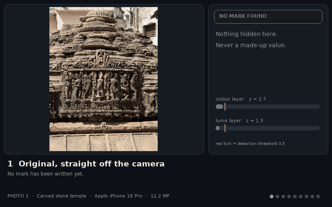
  <br/><sub><b>#1 · Carved stone temple</b><br/>Apple iPhone 16 Pro · 12 MP · PSNR 37.6 dB · chat-app z = 35<br/>✅ 11 full · 🟠 1 location-only (of 12 edits)</sub>
</td>
<td width="50%" align="center">
  
  <br/><sub><b>#2 · Step-well and water</b><br/>Apple iPhone 16 Pro · 12 MP · PSNR 41.1 dB · chat-app z = 18<br/>✅ 10 full · 🔴 2 unreadable (of 12 edits)</sub>
</td>
</tr>
<tr>
<td width="50%" align="center">
  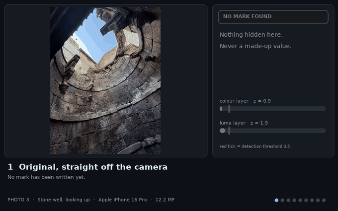
  <br/><sub><b>#3 · Stone well, looking up</b><br/>Apple iPhone 16 Pro · 12 MP · PSNR 38.0 dB · chat-app z = 31<br/>✅ 11 full · 🟠 1 location-only (of 12 edits)</sub>
</td>
<td width="50%" align="center">
  
  <br/><sub><b>#7 · Jetty and offshore rig</b><br/>Apple iPhone 16 Pro · 18 MP · PSNR 40.3 dB · chat-app z = 25<br/>✅ 10 full · 🟠 1 location-only · 🔴 1 unreadable (of 12 edits)</sub>
</td>
</tr>
</table>

### 🚁 DJI drone &nbsp;<sub>8 photos · average 10.4 of 12 edits survived with the full record</sub>

<table>
<tr>
<td width="50%" align="center">
  
  <br/><sub><b>#12 · Drone: scrubland</b><br/>DJI FC3411 · 17 MP · PSNR 37.9 dB · chat-app z = 29<br/>✅ 11 full · 🟠 1 location-only (of 12 edits)</sub>
</td>
<td width="50%" align="center">
  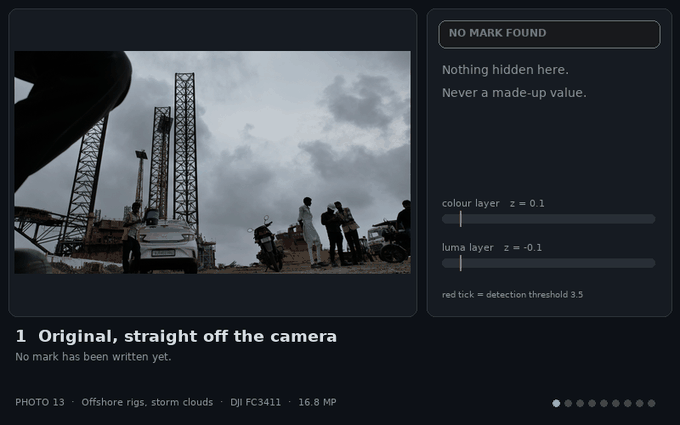
  <br/><sub><b>#13 · Offshore rigs, storm clouds</b><br/>DJI FC3411 · 17 MP · PSNR 42.6 dB · chat-app z = 18<br/>✅ 9 full · 🔴 3 unreadable (of 12 edits)</sub>
</td>
</tr>
<tr>
<td width="50%" align="center">
  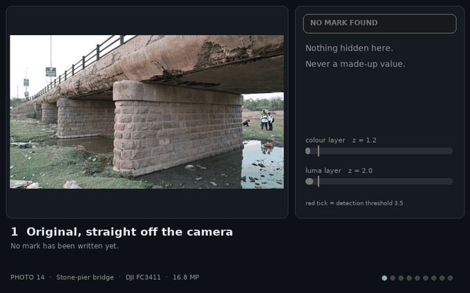
  <br/><sub><b>#14 · Stone-pier bridge</b><br/>DJI FC3411 · 17 MP · PSNR 39.2 dB · chat-app z = 20<br/>✅ 11 full · 🟠 1 location-only (of 12 edits)</sub>
</td>
<td width="50%" align="center">
  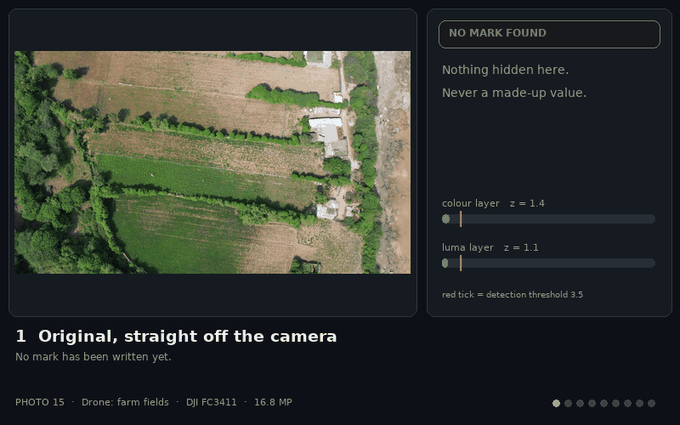
  <br/><sub><b>#15 · Drone: farm fields</b><br/>DJI FC3411 · 17 MP · PSNR 37.5 dB · chat-app z = 14<br/>✅ 8 full · 🟠 4 location-only (of 12 edits)</sub>
</td>
</tr>
<tr>
<td width="50%" align="center">
  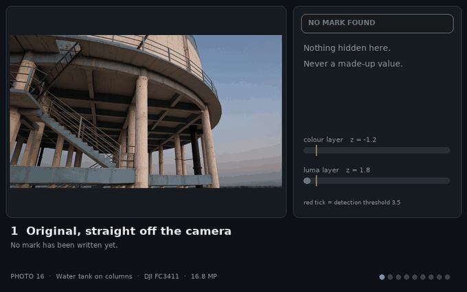
  <br/><sub><b>#16 · Water tank on columns</b><br/>DJI FC3411 · 17 MP · PSNR 42.5 dB · chat-app z = 23<br/>✅ 11 full · 🟠 1 location-only (of 12 edits)</sub>
</td>
<td width="50%" align="center">
  
  <br/><sub><b>#17 · River weir</b><br/>DJI FC3411 · 17 MP · PSNR 38.9 dB · chat-app z = 26<br/>✅ 11 full · 🟠 1 location-only (of 12 edits)</sub>
</td>
</tr>
<tr>
<td width="50%" align="center">
  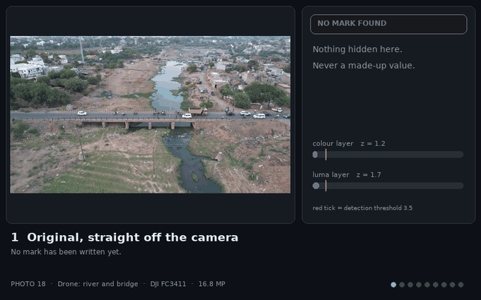
  <br/><sub><b>#18 · Drone: river and bridge</b><br/>DJI FC3411 · 17 MP · PSNR 38.8 dB · chat-app z = 21<br/>✅ 11 full · 🟠 1 location-only (of 12 edits)</sub>
</td>
<td width="50%" align="center">
  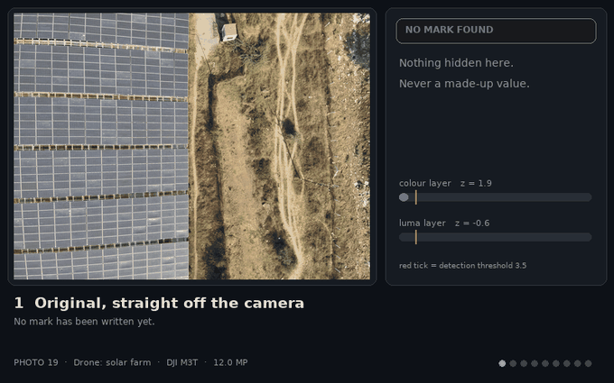
  <br/><sub><b>#19 · Drone: solar farm</b><br/>DJI M3T · 12 MP · PSNR 37.2 dB · chat-app z = 32<br/>✅ 11 full · 🟠 1 location-only (of 12 edits)</sub>
</td>
</tr>
</table>

### 📱 OnePlus &nbsp;<sub>4 photos · average 10.2 of 12 edits survived with the full record</sub>

<table>
<tr>
<td width="50%" align="center">
  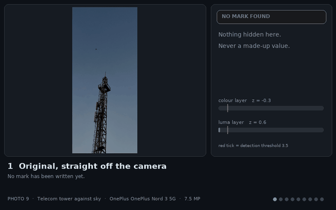
  <br/><sub><b>#9 · Telecom tower against sky</b><br/>OnePlus OnePlus Nord 3 5G · 8 MP · PSNR 46.3 dB · chat-app z = 13<br/>✅ 8 full · 🔴 4 unreadable (of 12 edits)</sub>
</td>
<td width="50%" align="center">
  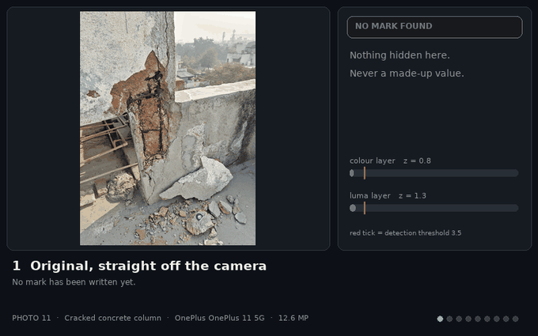
  <br/><sub><b>#11 · Cracked concrete column</b><br/>OnePlus OnePlus 11 5G · 13 MP · PSNR 37.9 dB · chat-app z = 33<br/>✅ 11 full · 🟠 1 location-only (of 12 edits)</sub>
</td>
</tr>
<tr>
<td width="50%" align="center">
  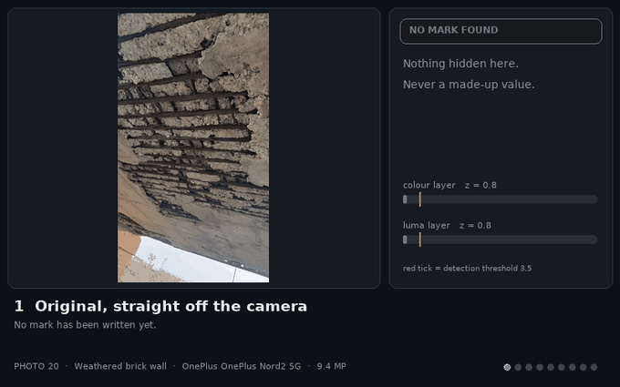
  <br/><sub><b>#20 · Weathered brick wall</b><br/>OnePlus OnePlus Nord2 5G · 9 MP · PSNR 39.8 dB · chat-app z = 29<br/>✅ 11 full · 🟠 1 location-only (of 12 edits)</sub>
</td>
<td width="50%" align="center">
  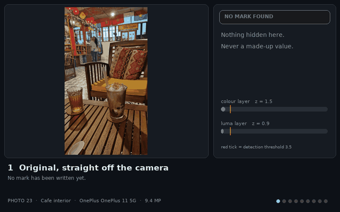
  <br/><sub><b>#23 · Cafe interior</b><br/>OnePlus OnePlus 11 5G · 9 MP · PSNR 40.2 dB · chat-app z = 14<br/>✅ 11 full · 🟠 1 location-only (of 12 edits)</sub>
</td>
</tr>
</table>

### 📱 vivo &nbsp;<sub>2 photos · average 11.0 of 12 edits survived with the full record</sub>

<table>
<tr>
<td width="50%" align="center">
  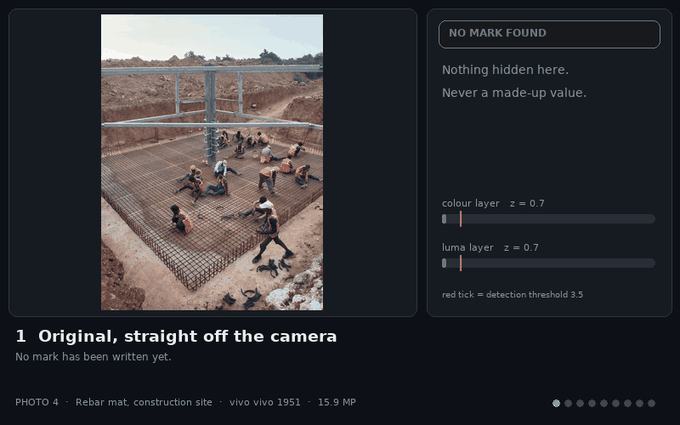
  <br/><sub><b>#4 · Rebar mat, construction site</b><br/>vivo vivo 1951 · 16 MP · PSNR 38.5 dB · chat-app z = 26<br/>✅ 11 full · 🟠 1 location-only (of 12 edits)</sub>
</td>
<td width="50%" align="center">
  
  <br/><sub><b>#5 · Crane erection site</b><br/>vivo vivo 1951 · 16 MP · PSNR 39.7 dB · chat-app z = 23<br/>✅ 11 full · 🟠 1 location-only (of 12 edits)</sub>
</td>
</tr>
</table>

### 📱 realme &nbsp;<sub>2 photos · average 10.0 of 12 edits survived with the full record</sub>

<table>
<tr>
<td width="50%" align="center">
  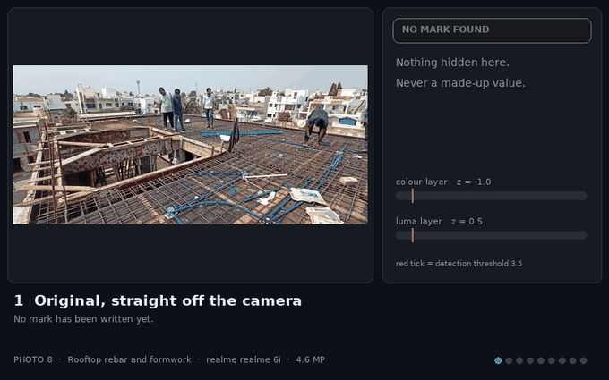
  <br/><sub><b>#8 · Rooftop rebar and formwork</b><br/>realme realme 6i · 5 MP · PSNR 38.4 dB · chat-app z = 17<br/>✅ 10 full · 🟠 1 location-only · 🔴 1 unreadable (of 12 edits)</sub>
</td>
<td width="50%" align="center">
  
  <br/><sub><b>#10 · Power line on a shoreline</b><br/>realme realme GT Master Edition · 12 MP · PSNR 44.2 dB · chat-app z = 22<br/>✅ 10 full · 🟠 1 location-only · 🔴 1 unreadable (of 12 edits)</sub>
</td>
</tr>
</table>

### 📱 LAVA &nbsp;<sub>3 photos · average 5.0 of 12 edits survived with the full record</sub>

<table>
<tr>
<td width="50%" align="center">
  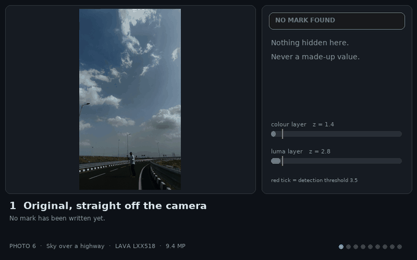
  <br/><sub><b>#6 · Sky over a highway</b><br/>LAVA LXX518 · 9 MP · PSNR 45.5 dB · chat-app z = 14<br/>✅ 9 full · 🔴 3 unreadable (of 12 edits)</sub>
</td>
<td width="50%" align="center">
  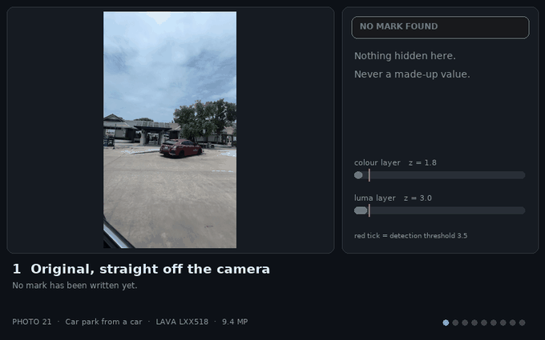
  <br/><sub><b>#21 · Car park from a car</b><br/>LAVA LXX518 · 9 MP · PSNR 43.9 dB · chat-app z = 10<br/>✅ 6 full · 🔴 6 unreadable (of 12 edits)</sub>
</td>
</tr>
<tr>
<td width="50%" align="center">
  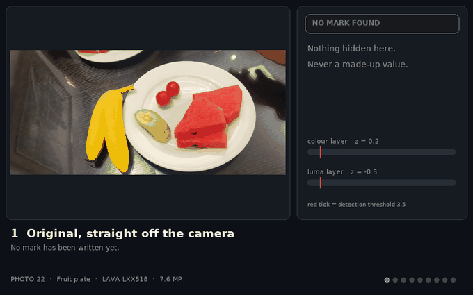
  <br/><sub><b>#22 · Fruit plate</b><br/>LAVA LXX518 · 8 MP · PSNR 43.4 dB · chat-app z = 6<br/>✅ 0 full · 🟠 6 location-only · 🔴 6 unreadable (of 12 edits)</sub>
</td>
<td width="50%"></td>
</tr>
</table>


## 📊 The lab results

### 🔥 Survival matrix: every photo × every edit

<div align="center">
  
  <p><em>Each cell is the colour-layer detection strength z (threshold 3.5) or a status: <b>LOC</b> = location only (orange frame), <b>DMG</b> = mark present but unreadable (red frame), <b>--</b> = no mark found. Photo labels are coloured by camera.</em></p>
</div>

<table>
<tr>
<td width="55%" align="center">
  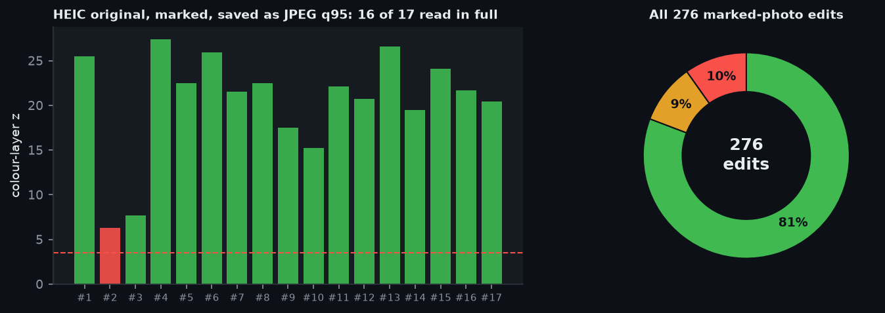
</td>
<td width="45%" valign="middle">

### The scoreboard

**276** attacked copies (23 photos × 12 edits):

- ✅ **223** full records (80.8 %)
- 🟠 **26** location-only recoveries
- 🔴 **27** honestly unreadable
- ❌ **0** wrong values
- 🚫 **0** false alarms on 184 unmarked reads (highest z 3.29 vs threshold 3.5)

</td>
</tr>
</table>

| Edit applied to the stored JPEG | Full record | Location only (layer 2 alone) | Median z |
|---|:-:|:-:|:-:|
| Stored JPEG q95 (full size) | 22 / 23 | 18 / 23 | 25 |
| Chat app: 1600 px, q70 | 22 / 23 | 18 / 23 | 23 |
| Social: 1080 px, q50 | 21 / 23 | 14 / 23 | 16 |
| Thumbnail: 800 px, q40 | 17 / 23 | 14 / 23 | 11 |
| Tiny: 600 px, q50 | 13 / 23 | 8 / 23 | 10 |
| Shared three times (1600 > 1280 > 1080) | 19 / 23 | 14 / 23 | 14 |
| Screenshot-style PNG, 1080 px | 22 / 23 | 18 / 23 | 24 |
| Brightness/contrast edit + 1600 q70 | 22 / 23 | 17 / 23 | 23 |
| Colour drained to 40% + 1600 q70 | 21 / 23 | 17 / 23 | 17 |
| Blur (sigma 1.2) + 1600 q70 | 22 / 23 | 14 / 23 | 21 |
| 25% of area painted over + 1600 q70 | 22 / 23 | 16 / 23 | 19 |
| Black and white + 1600 q70 | 0 / 23 | **18 / 23** (as `PART`) | n/a |
| Crop to 81% of the area (centre 90%), then chat app | 20 / 23 | n/a | n/a |
| Crop to 56% of the area (centre 75%), then chat app | 19 / 23 | n/a | n/a |
| Crop to 36% of the area (centre 60%), then chat app | 18 / 23 | n/a | n/a |
| Crop to 20% of the area (centre 45%), then chat app | 0 / 23 | n/a | n/a |
| Crop to 90% of the area (right 10% trimmed), then chat app | 20 / 23 | n/a | n/a |
| Crop to 25% of the area (top-left quarter), then chat app | 0 / 23 | n/a | n/a |
| Simulated phone photo of a **monitor** (4 tapped corners) | 20 / 23 | n/a | n/a |
| Simulated phone photo of a **print** (4 tapped corners) | 19 / 23 | n/a | n/a |
| HEIC original → mark → save as JPEG q95 | 16 / 17 | n/a | n/a |

### 📦 How strong is the signal? Distribution per edit

<div align="center">
  
  <p><em>Every dot is one photo. Boxes are quartiles; cyan is the median. Healthy copies sit at z = 15 to 35, the threshold is 3.5, and the unmarked control stays flat on the floor.</em></p>
</div>

### 📉 How small, how squashed?

<div align="center">
  
  <p><em>Top: z versus long edge (grey = each photo, cyan band = middle 50 %). Bottom left: the share of photos still read in full. Bottom right: JPEG quality alone, on a 1600 px copy.</em></p>
</div>

### 🕵️ Never cries wolf, and why busy scenes win

<div align="center">
  
  <p><em>Left: 184 reads of unmarked photos (8 degradations × 23 photos) never crossed the threshold; real reads start at z ≈ 7.2. Right: detection strength follows scene texture (r = 0.66).</em></p>
</div>

### ✂️ Crops, 📺 screens and ⏱️ speed

<div align="center">
  
  <p><em>Crop, then chat app: a 10 % trim or centred 90 % / 75 % / 60 % crop is found and read in most photos (20, 20, 19, 18 of 23); a 45 % or quarter-frame crop is not (0 and 0 of 23). Simulated phone photos of a monitor: 20 of 23 read in full; of a print: 19 of 23.</em></p>
</div>

### 📱 Does the camera matter?

<div align="center">
  
  <p><em>Left: edits survived per camera (dots = individual photos). Middle: marking time on the JavaScript reference engine, measured one photo at a time on one PC core (about 18.5 ms per megapixel, median 335.0 ms; the Kotlin engine on a phone takes ~1.2 s for 12 MP including the self-test). Right: a full-size read, median 97.0 ms.</em></p>
</div>

### 🎚️ The visibility ↔ survival trade-off

The mark strength is a dial. We re-marked every photo at five strengths and measured both invisibility and survival.

<div align="center">
  
</div>

| Strength (× default) | Mean PSNR | Chat app (1600 px q70) read in full | Thumbnail (800 px q40) read in full |
|:-:|:-:|:-:|:-:|
| 0.5× | 45.5 dB | 83% | 22% |
| 0.75× | 42.7 dB | 91% | 43% |
| **1× (default)** | **40.4 dB** | **96%** | **74%** |
| 1.5× | 37.1 dB | 100% | 87% |
| 2× | 34.6 dB | 100% | 96% |

**Take-away:** the default (1×) already reads 22 of 23 photos after a chat app, but only about three quarters survive an 800 px / q40 thumbnail. Raising the strength to 1.5× to 2× rescues most of the rest, at a visible cost (PSNR drops from about 40 to 35 dB). That is exactly why Ghostmark ships a **capture-time self-test**: it simulates a chat app on the fresh photo and raises the strength (up to 1.9×) *only for the photos that need it*, so a textured temple stays subtle and a smooth plate gets help. In this benchmark 6 photos are lost at 800 px / q40 with the 1× mark, and **5 of them are read in full once the strength is doubled**. The only photo that fails even as a stored copy at 1× is #22, a dark, smooth plate: exactly the case the self-test exists for.

## 🏆 Leaderboard: who survives best?

<div align="center">
  
</div>

<table>
<tr>
<td width="50%" valign="top">

**The five most robust photos**

| # | Scene | Camera | Texture | Brightness | Chat-app z | Full reads |
|:-:|---|---|:-:|:-:|:-:|:-:|
| 1 | Carved stone temple | iPhone 16 Pro | 0.95 | 111 | 35 | 11 / 12 |
| 11 | Cracked concrete column | OnePlus 11 5G | 0.88 | 151 | 33 | 11 / 12 |
| 19 | Drone: solar farm | M3T | 0.97 | 133 | 32 | 11 / 12 |
| 3 | Stone well, looking up | iPhone 16 Pro | 0.85 | 84 | 31 | 11 / 12 |
| 20 | Weathered brick wall | OnePlus Nord2 5G | 0.76 | 108 | 29 | 11 / 12 |

</td>
<td width="50%" valign="top">

**The five most fragile photos**

| # | Scene | Camera | Texture | Brightness | Chat-app z | Full reads |
|:-:|---|---|:-:|:-:|:-:|:-:|
| 22 | Fruit plate | LXX518 | 0.44 | 121 | 6 | 0 / 12 |
| 21 | Car park from a car | LXX518 | 0.41 | 152 | 10 | 6 / 12 |
| 9 | Telecom tower against sky | OnePlus Nord 3 5G | 0.31 | 91 | 13 | 8 / 12 |
| 15 | Drone: farm fields | FC3411 | 0.93 | 115 | 14 | 8 / 12 |
| 6 | Sky over a highway | LXX518 | 0.38 | 94 | 14 | 9 / 12 |

</td>
</tr>
</table>

## 🔬 What we learned

1. **Texture is destiny.** The marks that survive best live in rubble, rebar, stone and foliage. Flat sky, dark water and smooth plates are the weak spots, by design: the adaptive rule withholds the mark where it would be visible, and there is less pattern to hide in.
2. **Resolution matters more than JPEG quality.** The reader keeps working down to JPEG q10 at 1600 px, but falls apart below roughly 600 to 800 px on the long edge. Chat apps resize; they rarely crush quality that far.
3. **The luma layer earns its place.** Convert a photo to black &amp; white and the colour layer is gone for every photo. The brightness layer still returned the location for **18 of 23** photos, which is the whole point of having two independent layers.
4. **Never a wrong answer.** The CRC-16 plus the convolutional code turned every uncertain read into an honest `PART` or `DAMAGED`, not into a plausible-looking wrong coordinate: **0 wrong values** across 276 edits and 184 unmarked controls.
5. **It survives a format change.** HEIC originals decoded, marked and saved as JPEG q95 were read in full for **16 of 17** photos.
6. **Photos of screens and prints are viable, with help.** With four tapped corners the reader aligned and decoded 20 of 23 simulated monitor shots and 19 of 23 print shots; that takes about 16.3 s per photo on a PC core, and 24 to 55 s on a phone. Real hardware is harsher than the simulator, see the limits below.
7. **Drones are fine.** Aerial scenes (fields, scrub, solar panels) are almost pure texture: the 8 DJI photos survived 10.4 of 12 edits on average, on par with the flagship phones (10.5); the weakest group was the budget LAVA phone (5.0), whose photos here were the smoothest and darkest.

## ⚙️ How it works

<div align="center">
  
</div>

<table>
<tr>
<td width="25%" valign="top">

**🎨 Layer 1: colour**

~10,000 tiles in Cb/Cr, ±(≤2) grey levels. 118 bits: location, altitude, time, 0.1 s, live/manual, CRC-16. Rate-½ convolutional code → 248 coded bits, ~32 tiles per bit.

</td>
<td width="25%" valign="top">

**💡 Layer 2: brightness**

~50,000 tiles in luma carry only the location (60 bits, ~10 m). Weaker, but it **survives black &amp; white**.

</td>
<td width="25%" valign="top">

**📍 Pilot tiles**

20% of tiles have a known sign. The reader correlates against them to detect, to align after a crop, to fix a tilted photo of a screen, and as a built-in false-alarm test.

</td>
<td width="25%" valign="top">

**🛡️ Self-test**

At capture the engine squeezes a copy like a chat app would, reads it, and strengthens the mark (up to ×1.9) if it did not survive.

</td>
</tr>
</table>

<div align="center">
  
</div>

<div align="center">
  
  <p><em>Case study: photo #1 through eight stages. The unmarked original returns "no mark", never a guess.</em></p>
</div>

Exact bit layout: [FORMAT-SPEC.md](engine/FORMAT-SPEC.md). The JavaScript implementation in [`reference/`](reference/) wins over the text if they ever disagree.

## ⚠️ Honest limits

<table>
<tr>
<td width="50%" valign="top">

- **Not a proof of authenticity.** Anyone with the engine can write a mark. It keeps *honest* metadata alive; a tamper hint fires if the two layers disagree by more than 30 m.
- **Flat, dark or smooth photos are fragile** (see the leaderboard): fine at chat size, lost at small sizes unless the self-test strengthens them.
- **Black &amp; white** keeps the location only, and very dark or flat photos can lose even that.
- **Crops:** centred crops down to about 36 % of the area were found; a 20 % or quarter-frame crop was not.

</td>
<td width="50%" valign="top">

- **Photos of screens:** the simulator is kinder than reality. A real monitor photo read (z = 12.7, 24 s on the phone); another, shown at 100 % zoom with strong moiré, was lost.
- **Not supported:** heavy denoising or AI retouching, pictures below 64 px, times before 2026-01-01 or after ~2043.
- **Benchmark scope:** attacks ran on the JavaScript reference engine at default strength, on 23 photos from 10 cameras. Treat percentages as indicative, not as a guarantee for every scene.

</td>
</tr>
</table>

## 🚀 Quick start

```kotlin
// settings.gradle.kts → include(":engine")   |   app → implementation(project(":engine"))
// 1. At capture, after your overlay is drawn and before JPEG encoding (background thread):
val record = MarkRecord(lat, lon, altitudeMeters = alt, timeSeconds = Math.floorDiv(shutterMillis, 1000L),
                        tenth = (Math.floorMod(shutterMillis, 1000L) / 100).toInt())
InvisibleMark.mark(finalBitmap, record)            // null = failed: save the photo unmarked

// 2. Any time later, on any copy:
val read = InvisibleMark.read(context, uri, ReadOptions(searchCrops = true))
when (read?.result?.status) {                      // OK · PART · DAMAGED · NONE
    MarkStatus.OK   -> read.result.layer1          // lat, lon, alt, time, manual flag
    MarkStatus.PART -> read.result.layer2          // location only, ~10 m
    else -> { /* tell the user. never invent a value */ }
}
```

Full API, four integration flows and an AI-assistant checklist: [`engine/ENGINE.md`](engine/ENGINE.md).

| | Measured on a real phone (12 MP) |
|---|---|
| Mark (embed + self-test) | ~0.65 s + ~0.56 s |
| Read | ~0.15 s |
| Read with crop search | 2.5 to 4.6 s |
| Read a photo of a screen / print | 24 s (clean case) to ~55 s |

## 📦 What's in the box

```
engine/       the library: source, ENGINE.md, FORMAT-SPEC.md, 29 JVM tests with cross-language fixtures
dist/         prebuilt ghostmark-1.1.0.aar (97 KB)
trial/        small Compose sample app: Capture, Read, Screen/print with a corner editor
reference/    JavaScript reference implementation + CLI
samples/      demo photos, marked (1600 px, EXIF-free): send them through any messenger and read them back
tools/        run_experiments.py → make_figures.py → make_showcase.py → make_readme.py (builds this page from the data)
assets/       README media
```

```
gradlew :engine:testDebugUnitTest :engine:assembleRelease :trial:assembleDebug
cd tools && python run_experiments.py && python make_figures.py && python make_showcase.py && python make_readme.py
# needs numpy, opencv-python, matplotlib, pillow, pillow-heif, node. Set MARK_PHOTOS=<folder> to use your own photos.
```

Benchmark note: attacks ran on the JavaScript reference engine, which shares format and maths with the Kotlin engine (cross-checked by shared fixtures in both directions). Photos above 24 MP are downscaled to a 4096 px long edge first, as the Android engine does. On-phone timings and the two real monitor photos come from the Kotlin engine on a 1220 × 2712 Android phone.

## 📜 Licence and credit

Copyright © 2026 **Vijay Parmar**. Free to use, modify and ship inside your own apps, including commercial ones, **as long as you credit the author**, for example in your About screen:

> Uses Ghostmark by Vijay Parmar, github.com/thevijayparmar/Ghostmark-Image

The engine may not be resold or republished as a stand-alone library or SDK. The binding text is in [LICENSE](LICENSE).

**Contributors:** [Vijay Parmar](https://github.com/thevijayparmar) · [Prathvi Bhatti](https://github.com/poronita) (co-author)

<div align="center">
  <br/>
  <sub>👻 Built by <a href="https://github.com/thevijayparmar">Vijay Parmar</a> · the photo remembers, even when the file forgets.</sub>
</div>
