<div align="center">
  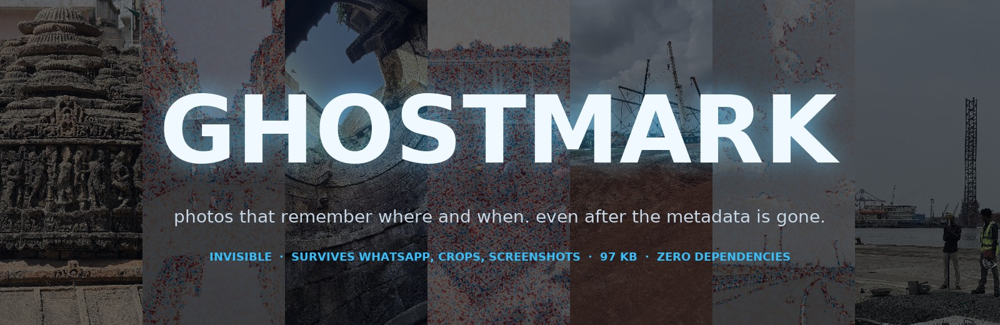
</div>

<br>

<div align="center">

  <a href="LICENSE"></a>
  
  
  <a href="https://pypi.org/project/ghostmark-image/"></a>
  
  <a href="https://github.com/thevijayparmar/Ghostmark-Image/actions/workflows/python.yml"></a>
  
  
  
  
  
  

</div>

<br>

<div align="center">
  
  <h1>Ghostmark</h1>
  <p><strong>Photos that remember where and when they were taken, even after the metadata is gone.</strong></p>
  <p>A library that hides <b>location (~1 m), altitude, UTC time (0.1 s)</b> and a live/manual flag <i>inside the pixels</i> of a photo, invisibly, so the record survives WhatsApp, screenshots, crops, <b>black &amp; white filters</b> and even a phone photo of a screen.</p>
  <p><b>One mark format, three engines:</b> 🤖 Android (Kotlin) · 🐍 Python (new) · 🌐 JavaScript reference</p>
  <p><code>Ghostmark-Image</code> · engine 1.1.0 · no UI · no permissions · no network · no native code</p>
</div>

<div align="center">
  <a href="https://www.linkedin.com/in/thevijayparmar/">
    
  </a>
  &nbsp;
  <a href="../../issues">
    
  </a>
  &nbsp;
  <a href="../../issues">
    
  </a>
</div>

---

> ⏳ **Heads up: this page is long and animation-heavy on purpose.** It is a lab notebook as much as a README: 40 real photos from 11 different cameras (phones and drones), 480 attacked copies, 18 charts, 40 animated test reels and a black-and-white special. Skim the pictures, or read every number. Everything is generated from scripts in [`tools/`](tools/), nothing is typed by hand.

<div align="center">
  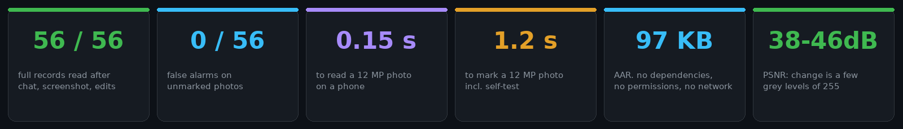
</div>

---

## 📖 Contents

| | | |
|---|---|---|
| [🎬 See it in action](#-see-it-in-action) | [🌗 Black & white special](#-black--white-the-second-layer) | [📊 The lab results](#-the-lab-results) |
| [🧪 The test bench](#-the-test-bench) | [🎞️ The gauntlet (reels)](#️-the-gauntlet) | [🔬 What we learned](#-what-we-learned) |
| [🧬 The hidden layer](#-the-hidden-layer-made-visible) | [🏆 Leaderboard](#-leaderboard-who-survives-best) | [⚙️ How it works](#️-how-it-works) |
| [🐍 Ghostmark for Python](#-ghostmark-for-python) | [🚀 Quick start](#-quick-start) | [⚠️ Honest limits](#️-honest-limits) |

---

## 🎬 See it in action

<div align="center">
  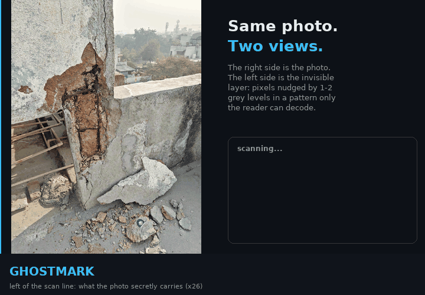
  <p><em>One photo, two views. The scan line reveals the invisible pattern that carries the record, then the reader decodes it in 0.15 s.</em></p>
</div>

<table>
<tr>
<td width="33%" valign="top">

### 😶 The problem

GPS and time live in **file metadata**. A chat app, a screenshot, a "save as" or a crop deletes them silently, and then the photo is just a picture. For anyone whose photos are *evidence* (inspectors, surveyors, insurers) that is a real loss.

</td>
<td width="33%" valign="top">

### 👻 The trick

Spread a 118-bit record over ~10,000 colour tiles (and a 60-bit location backup over ~50,000 brightness tiles), protect it with a CRC and an error-correcting code, and push each tile by only **1 to 2 grey levels**. Invisible to the eye, readable by the reader.

</td>
<td width="33%" valign="top">

### ✅ The proof

**329 of 360** chat, share, screenshot and edit copies gave back the **full record**; **0 false alarms** in 320 unmarked reads; **0 wrong values** across 480 edits. Median image change: **41.8 dB PSNR**, SSIM **0.9974**.

</td>
</tr>
</table>

## 🧪 The test bench

Not studio shots: **40 real photos from 11 camera models**: iPhone 16 Pro and 17 Pro, OnePlus, vivo, realme, a budget LAVA, and DJI drones, from 4.6 MP to 18.4 MP. Stone carvings, rebar, steel rigs, solar panels, temple spires, a castle in fog, a storm over a night sea, a moon over a bay, rain-soaked streets, blossoms, a plate of fruit and a café table. Easy, textured scenes **and** the awkward ones: flat sky, dark water, fog, night.

<div align="center">
  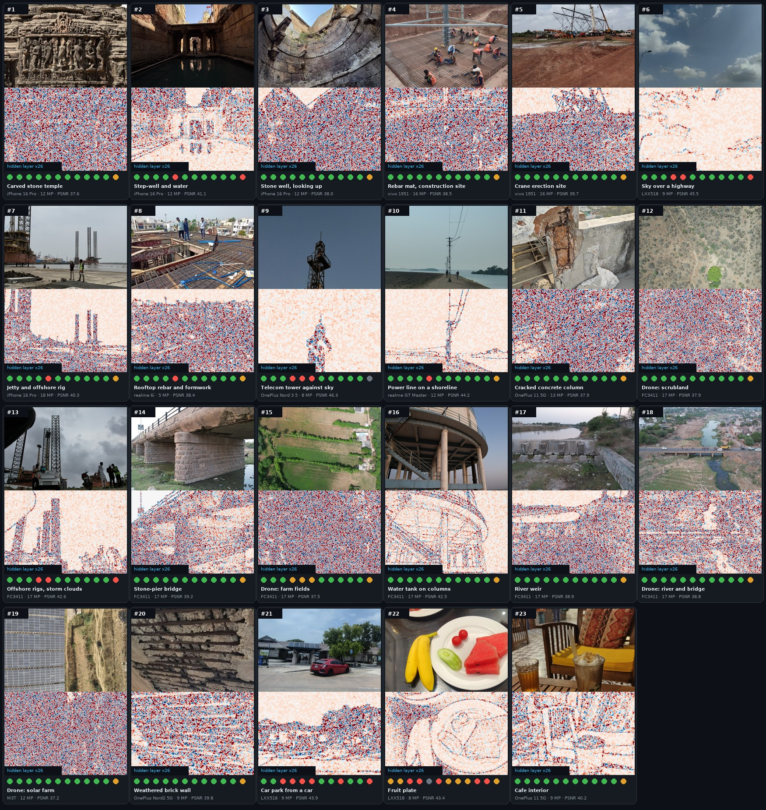
  <p><em>Every test photo, its hidden layer (×26) and 12 result dots: <b>green</b> = full record read, <b>orange</b> = location only, <b>red</b> = mark present but unreadable, <b>grey</b> = nothing found. Hover-free, no cherry-picking: this is the whole bench.</em></p>
</div>

| Camera | Photos | Sensor / type | Avg. edits survived | Median PSNR |
|---|:-:|---|:-:|:-:|
| 📱 iPhone 17 Pro | 17 | iPhone 17 Pro | 8.7 / 12 | 43.0 dB |
| 📱 iPhone 16 Pro | 4 | iPhone 16 Pro | 10.5 / 12 | 39.2 dB |
| 🚁 DJI drone | 8 | FC3411, M3T | 10.4 / 12 | 38.8 dB |
| 📱 OnePlus | 4 | OnePlus 11 5G, OnePlus Nord 3 5G, OnePlus Nord2 5G | 10.2 / 12 | 40.0 dB |
| 📱 vivo | 2 | vivo 1951 | 11.0 / 12 | 39.1 dB |
| 📱 realme | 2 | realme 6i, realme GT Master Edition | 10.0 / 12 | 41.3 dB |
| 📱 LAVA | 3 | LXX518 | 5.0 / 12 | 43.9 dB |

## 🧬 The hidden layer, made visible

The mark is the **difference** between the marked and the original photo, magnified 26 times (red/blue = pixels pushed up/down). Notice where it *isn't*: flat sky, dark water and smooth plates receive almost nothing. That is the **texture-adaptive** rule keeping the change invisible exactly where your eye would catch it.

<div align="center">
  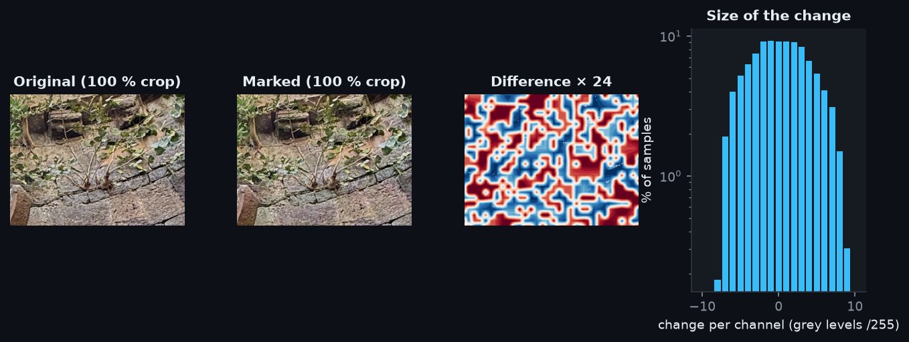
  <p><em>A 100 % crop, before and after. The difference map (×24) shows a smooth, low-frequency pattern; the histogram shows no pixel channel moves by more than 9 levels.</em></p>
</div>

<div align="center">
  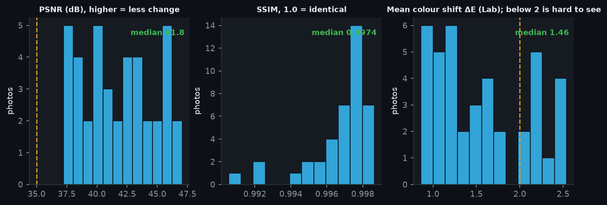
  <p><em>How big is the change, across all 40 photos? Median PSNR <b>41.8 dB</b> (range 37.2 to 47.1), median SSIM <b>0.9974</b>, median colour shift ΔE <b>1.5</b> (a ΔE of about 2 is the edge of what a trained eye notices side by side). Mean absolute change 1.4 grey levels of 255; the file grows by at most 9.0 %.</em></p>
</div>

## 🎞️ The gauntlet

Every photo was marked with the same demo record (12.97160 N, 77.59457 E, 920 m, 2026-10-25 12:00:00.4 UTC) and put through the **same nine steps**: original, hidden layer, saved, chat app, 600 px thumbnail, black &amp; white, a quarter painted over, a 10 % crop, and a (simulated) phone photo of a monitor. Green = full record back, orange = location only, red = mark present but unreadable. **Failures are shown on purpose.**

### 📱 iPhone 17 Pro &nbsp;<sub>17 photos · average 8.7 of 12 edits survived with the full record</sub>

<table>
<tr>
<td width="50%" align="center">
  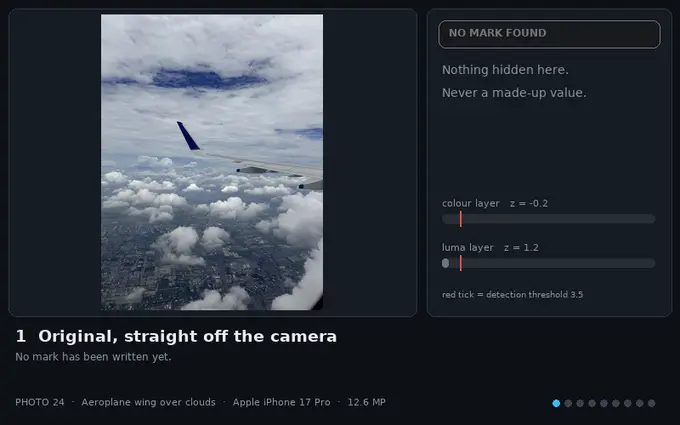
  <br/><sub><b>#24 · Aeroplane wing over clouds</b><br/>Apple iPhone 17 Pro · 13 MP · PSNR 42.3 dB · chat-app z = 22<br/>✅ 11 full · 🟠 1 location-only (of 12 edits)</sub>
</td>
<td width="50%" align="center">
  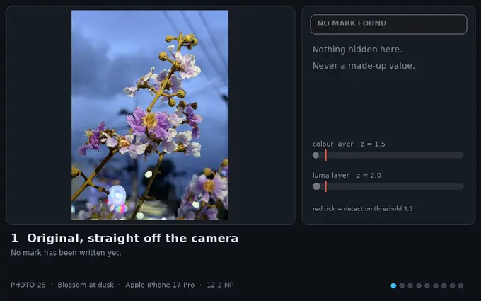
  <br/><sub><b>#25 · Blossom at dusk</b><br/>Apple iPhone 17 Pro · 12 MP · PSNR 43.0 dB · chat-app z = 6<br/>✅ 0 full · 🟠 8 location-only · 🔴 4 unreadable (of 12 edits)</sub>
</td>
</tr>
<tr>
<td width="50%" align="center">
  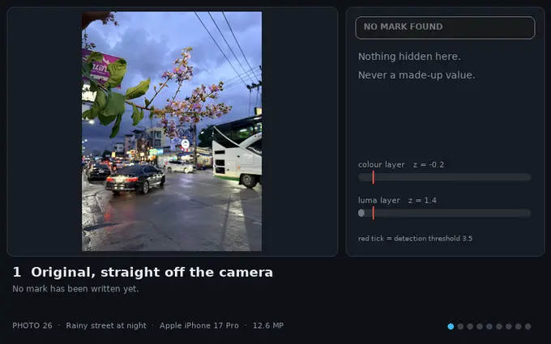
  <br/><sub><b>#26 · Rainy street at night</b><br/>Apple iPhone 17 Pro · 13 MP · PSNR 41.3 dB · chat-app z = 7<br/>✅ 6 full · 🟠 2 location-only · 🔴 4 unreadable (of 12 edits)</sub>
</td>
<td width="50%" align="center">
  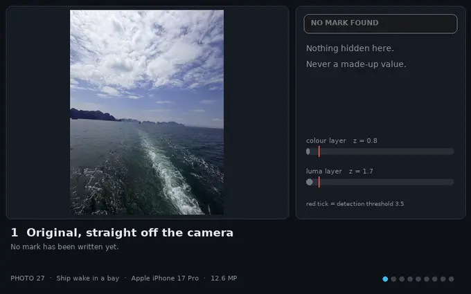
  <br/><sub><b>#27 · Ship wake in a bay</b><br/>Apple iPhone 17 Pro · 13 MP · PSNR 41.6 dB · chat-app z = 25<br/>✅ 11 full · 🟠 1 location-only (of 12 edits)</sub>
</td>
</tr>
<tr>
<td width="50%" align="center">
  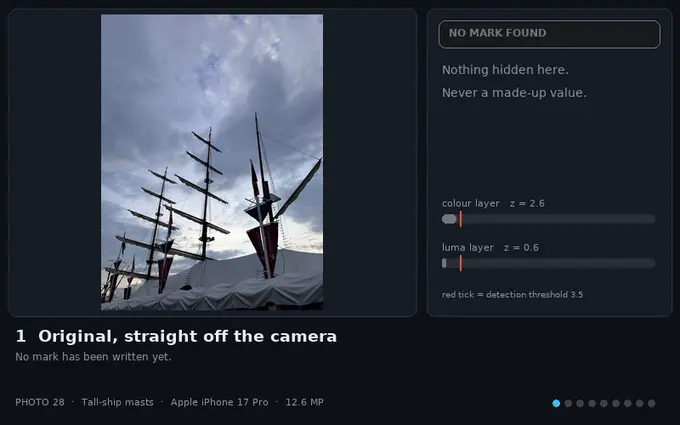
  <br/><sub><b>#28 · Tall-ship masts</b><br/>Apple iPhone 17 Pro · 13 MP · PSNR 43.0 dB · chat-app z = 20<br/>✅ 10 full · 🔴 2 unreadable (of 12 edits)</sub>
</td>
<td width="50%" align="center">
  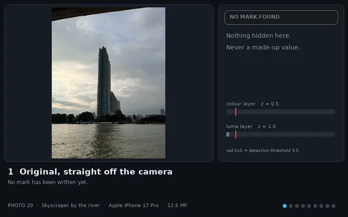
  <br/><sub><b>#29 · Skyscraper by the river</b><br/>Apple iPhone 17 Pro · 13 MP · PSNR 41.9 dB · chat-app z = 23<br/>✅ 11 full · 🟠 1 location-only (of 12 edits)</sub>
</td>
</tr>
<tr>
<td width="50%" align="center">
  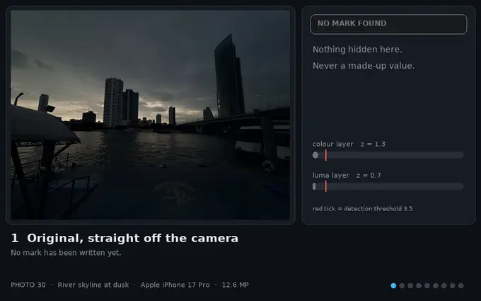
  <br/><sub><b>#30 · River skyline at dusk</b><br/>Apple iPhone 17 Pro · 13 MP · PSNR 44.7 dB · chat-app z = 17<br/>✅ 9 full · 🟠 1 location-only · 🔴 2 unreadable (of 12 edits)</sub>
</td>
<td width="50%" align="center">
  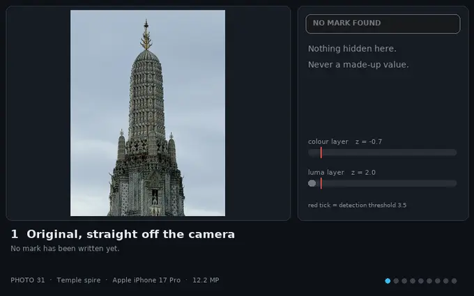
  <br/><sub><b>#31 · Temple spire</b><br/>Apple iPhone 17 Pro · 12 MP · PSNR 42.3 dB · chat-app z = 20<br/>✅ 11 full · 🔴 1 unreadable (of 12 edits)</sub>
</td>
</tr>
<tr>
<td width="50%" align="center">
  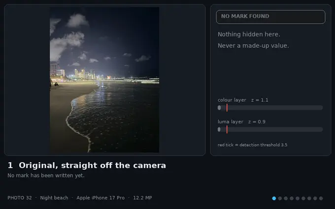
  <br/><sub><b>#32 · Night beach</b><br/>Apple iPhone 17 Pro · 12 MP · PSNR 43.5 dB · chat-app z = 15<br/>✅ 9 full · 🔴 3 unreadable (of 12 edits)</sub>
</td>
<td width="50%" align="center">
  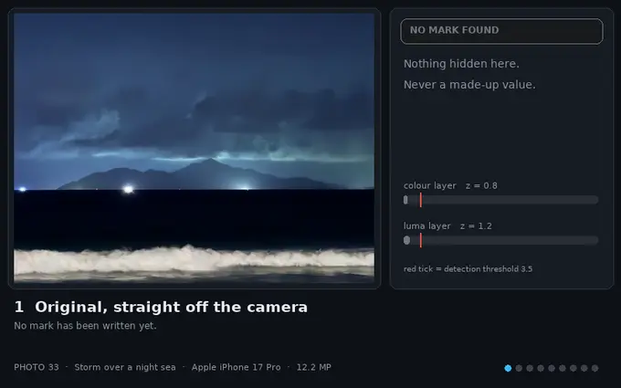
  <br/><sub><b>#33 · Storm over a night sea</b><br/>Apple iPhone 17 Pro · 12 MP · PSNR 47.1 dB · chat-app z = 12<br/>✅ 7 full · 🔴 5 unreadable (of 12 edits)</sub>
</td>
</tr>
<tr>
<td width="50%" align="center">
  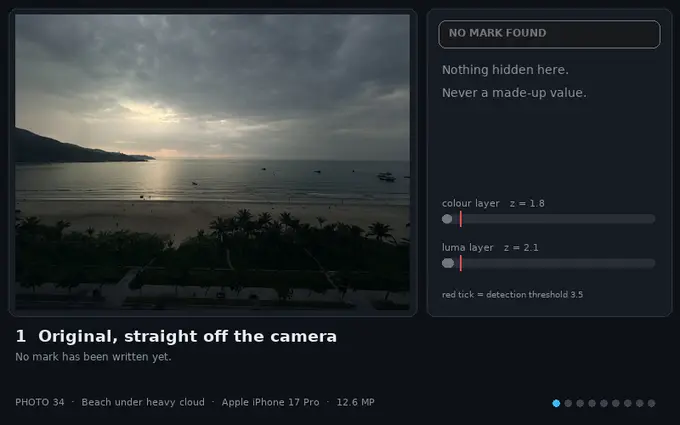
  <br/><sub><b>#34 · Beach under heavy cloud</b><br/>Apple iPhone 17 Pro · 13 MP · PSNR 45.0 dB · chat-app z = 18<br/>✅ 9 full · 🟠 1 location-only · 🔴 2 unreadable (of 12 edits)</sub>
</td>
<td width="50%" align="center">
  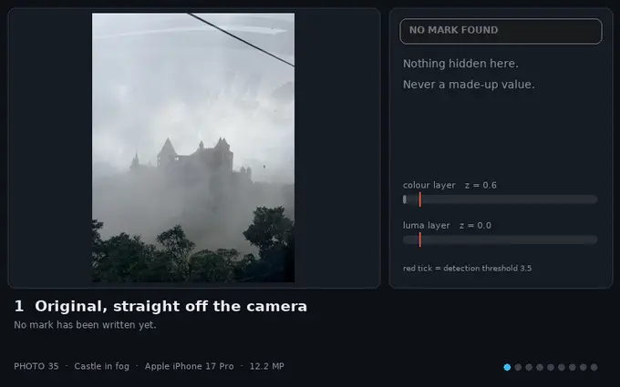
  <br/><sub><b>#35 · Castle in fog</b><br/>Apple iPhone 17 Pro · 12 MP · PSNR 45.9 dB · chat-app z = 16<br/>✅ 9 full · 🔴 3 unreadable (of 12 edits)</sub>
</td>
</tr>
<tr>
<td width="50%" align="center">
  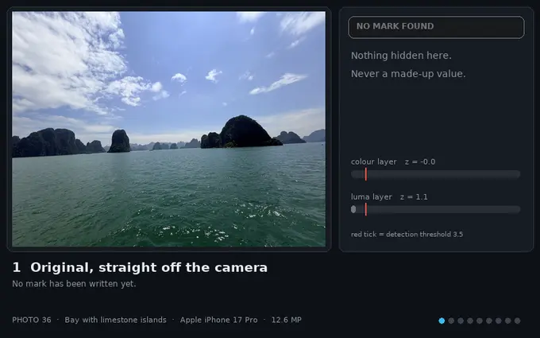
  <br/><sub><b>#36 · Bay with limestone islands</b><br/>Apple iPhone 17 Pro · 13 MP · PSNR 41.1 dB · chat-app z = 23<br/>✅ 10 full · 🟠 2 location-only (of 12 edits)</sub>
</td>
<td width="50%" align="center">
  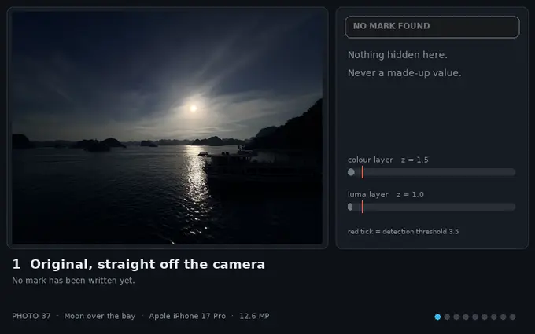
  <br/><sub><b>#37 · Moon over the bay</b><br/>Apple iPhone 17 Pro · 13 MP · PSNR 45.9 dB · chat-app z = 16<br/>✅ 8 full · 🔴 4 unreadable (of 12 edits)</sub>
</td>
</tr>
<tr>
<td width="50%" align="center">
  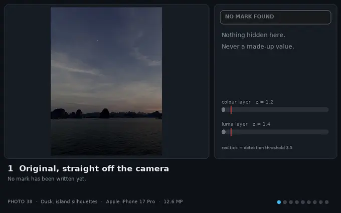
  <br/><sub><b>#38 · Dusk, island silhouettes</b><br/>Apple iPhone 17 Pro · 13 MP · PSNR 45.9 dB · chat-app z = 19<br/>✅ 8 full · 🟠 3 location-only · 🔴 1 unreadable (of 12 edits)</sub>
</td>
<td width="50%" align="center">
  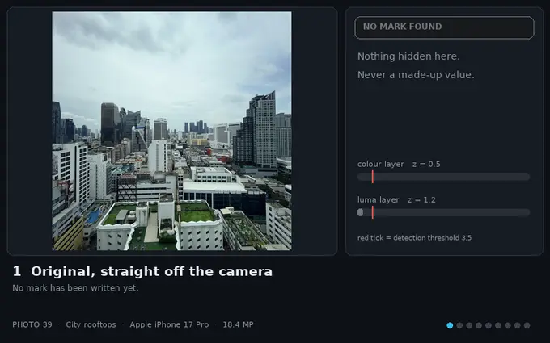
  <br/><sub><b>#39 · City rooftops</b><br/>Apple iPhone 17 Pro · 18 MP · PSNR 40.2 dB · chat-app z = 21<br/>✅ 11 full · 🟠 1 location-only (of 12 edits)</sub>
</td>
</tr>
<tr>
<td width="50%" align="center">
  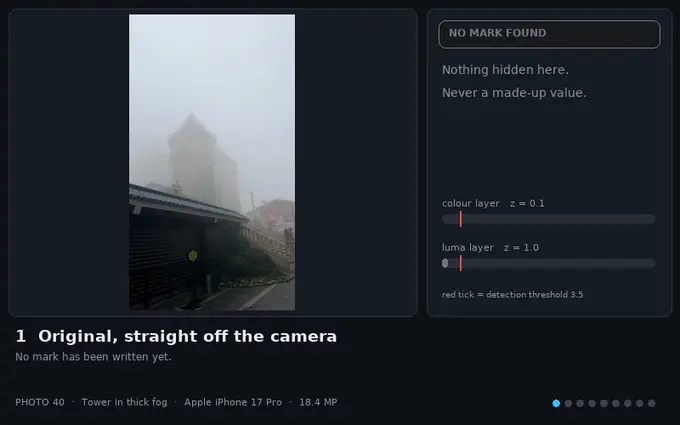
  <br/><sub><b>#40 · Tower in thick fog</b><br/>Apple iPhone 17 Pro · 18 MP · PSNR 45.6 dB · chat-app z = 16<br/>✅ 8 full · 🟠 3 location-only · 🔴 1 unreadable (of 12 edits)</sub>
</td>
<td width="50%"></td>
</tr>
</table>

### 📱 iPhone 16 Pro &nbsp;<sub>4 photos · average 10.5 of 12 edits survived with the full record</sub>

<table>
<tr>
<td width="50%" align="center">
  
  <br/><sub><b>#1 · Carved stone temple</b><br/>Apple iPhone 16 Pro · 12 MP · PSNR 37.6 dB · chat-app z = 35<br/>✅ 11 full · 🟠 1 location-only (of 12 edits)</sub>
</td>
<td width="50%" align="center">
  
  <br/><sub><b>#2 · Step-well and water</b><br/>Apple iPhone 16 Pro · 12 MP · PSNR 41.1 dB · chat-app z = 18<br/>✅ 10 full · 🔴 2 unreadable (of 12 edits)</sub>
</td>
</tr>
<tr>
<td width="50%" align="center">
  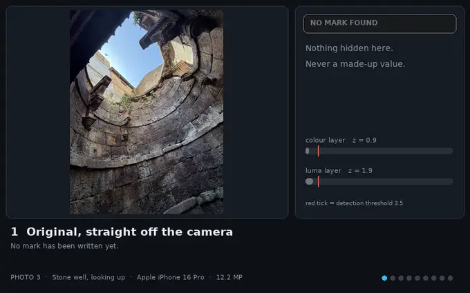
  <br/><sub><b>#3 · Stone well, looking up</b><br/>Apple iPhone 16 Pro · 12 MP · PSNR 38.0 dB · chat-app z = 31<br/>✅ 11 full · 🟠 1 location-only (of 12 edits)</sub>
</td>
<td width="50%" align="center">
  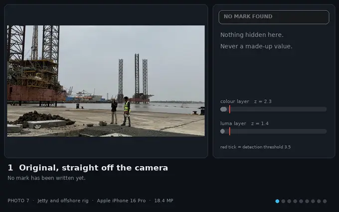
  <br/><sub><b>#7 · Jetty and offshore rig</b><br/>Apple iPhone 16 Pro · 18 MP · PSNR 40.3 dB · chat-app z = 25<br/>✅ 10 full · 🟠 1 location-only · 🔴 1 unreadable (of 12 edits)</sub>
</td>
</tr>
</table>

### 🚁 DJI drone &nbsp;<sub>8 photos · average 10.4 of 12 edits survived with the full record</sub>

<table>
<tr>
<td width="50%" align="center">
  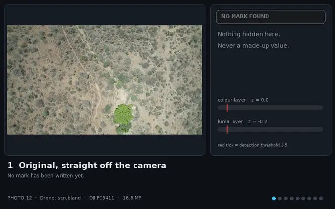
  <br/><sub><b>#12 · Drone: scrubland</b><br/>DJI FC3411 · 17 MP · PSNR 37.9 dB · chat-app z = 29<br/>✅ 11 full · 🟠 1 location-only (of 12 edits)</sub>
</td>
<td width="50%" align="center">
  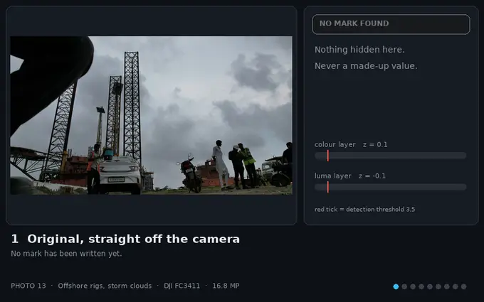
  <br/><sub><b>#13 · Offshore rigs, storm clouds</b><br/>DJI FC3411 · 17 MP · PSNR 42.6 dB · chat-app z = 18<br/>✅ 9 full · 🔴 3 unreadable (of 12 edits)</sub>
</td>
</tr>
<tr>
<td width="50%" align="center">
  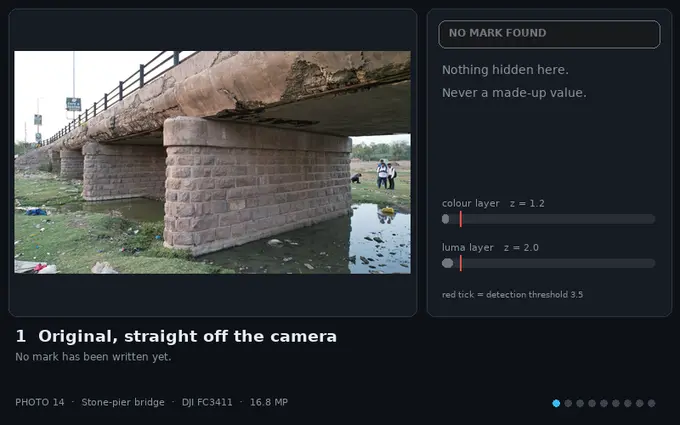
  <br/><sub><b>#14 · Stone-pier bridge</b><br/>DJI FC3411 · 17 MP · PSNR 39.2 dB · chat-app z = 20<br/>✅ 11 full · 🟠 1 location-only (of 12 edits)</sub>
</td>
<td width="50%" align="center">
  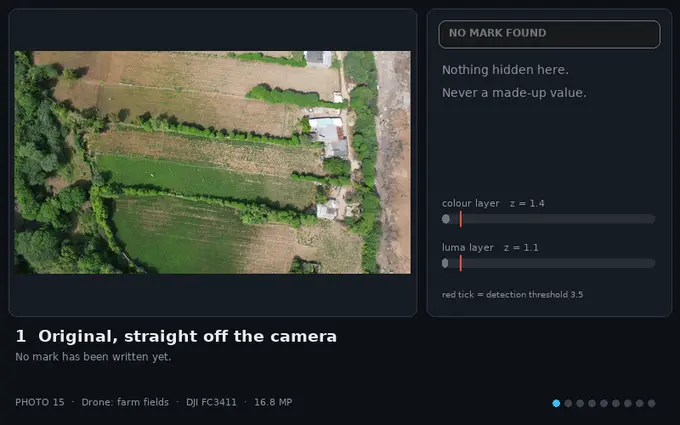
  <br/><sub><b>#15 · Drone: farm fields</b><br/>DJI FC3411 · 17 MP · PSNR 37.5 dB · chat-app z = 14<br/>✅ 8 full · 🟠 4 location-only (of 12 edits)</sub>
</td>
</tr>
<tr>
<td width="50%" align="center">
  
  <br/><sub><b>#16 · Water tank on columns</b><br/>DJI FC3411 · 17 MP · PSNR 42.5 dB · chat-app z = 23<br/>✅ 11 full · 🟠 1 location-only (of 12 edits)</sub>
</td>
<td width="50%" align="center">
  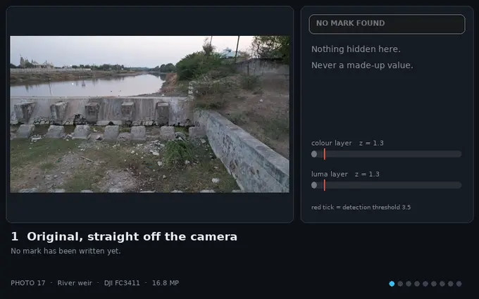
  <br/><sub><b>#17 · River weir</b><br/>DJI FC3411 · 17 MP · PSNR 38.9 dB · chat-app z = 26<br/>✅ 11 full · 🟠 1 location-only (of 12 edits)</sub>
</td>
</tr>
<tr>
<td width="50%" align="center">
  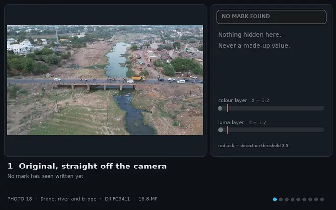
  <br/><sub><b>#18 · Drone: river and bridge</b><br/>DJI FC3411 · 17 MP · PSNR 38.8 dB · chat-app z = 21<br/>✅ 11 full · 🟠 1 location-only (of 12 edits)</sub>
</td>
<td width="50%" align="center">
  
  <br/><sub><b>#19 · Drone: solar farm</b><br/>DJI M3T · 12 MP · PSNR 37.2 dB · chat-app z = 32<br/>✅ 11 full · 🟠 1 location-only (of 12 edits)</sub>
</td>
</tr>
</table>

### 📱 OnePlus &nbsp;<sub>4 photos · average 10.2 of 12 edits survived with the full record</sub>

<table>
<tr>
<td width="50%" align="center">
  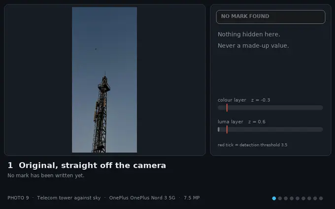
  <br/><sub><b>#9 · Telecom tower against sky</b><br/>OnePlus OnePlus Nord 3 5G · 8 MP · PSNR 46.3 dB · chat-app z = 13<br/>✅ 8 full · 🔴 4 unreadable (of 12 edits)</sub>
</td>
<td width="50%" align="center">
  
  <br/><sub><b>#11 · Cracked concrete column</b><br/>OnePlus OnePlus 11 5G · 13 MP · PSNR 37.9 dB · chat-app z = 33<br/>✅ 11 full · 🟠 1 location-only (of 12 edits)</sub>
</td>
</tr>
<tr>
<td width="50%" align="center">
  
  <br/><sub><b>#20 · Weathered brick wall</b><br/>OnePlus OnePlus Nord2 5G · 9 MP · PSNR 39.8 dB · chat-app z = 29<br/>✅ 11 full · 🟠 1 location-only (of 12 edits)</sub>
</td>
<td width="50%" align="center">
  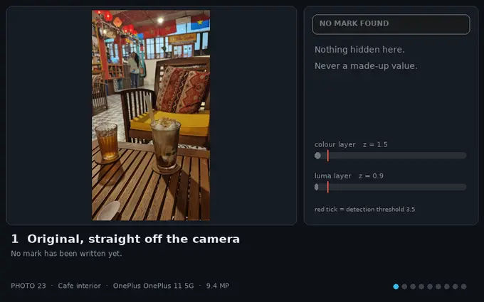
  <br/><sub><b>#23 · Cafe interior</b><br/>OnePlus OnePlus 11 5G · 9 MP · PSNR 40.2 dB · chat-app z = 14<br/>✅ 11 full · 🟠 1 location-only (of 12 edits)</sub>
</td>
</tr>
</table>

### 📱 vivo &nbsp;<sub>2 photos · average 11.0 of 12 edits survived with the full record</sub>

<table>
<tr>
<td width="50%" align="center">
  
  <br/><sub><b>#4 · Rebar mat, construction site</b><br/>vivo vivo 1951 · 16 MP · PSNR 38.5 dB · chat-app z = 26<br/>✅ 11 full · 🟠 1 location-only (of 12 edits)</sub>
</td>
<td width="50%" align="center">
  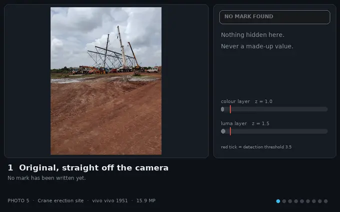
  <br/><sub><b>#5 · Crane erection site</b><br/>vivo vivo 1951 · 16 MP · PSNR 39.7 dB · chat-app z = 23<br/>✅ 11 full · 🟠 1 location-only (of 12 edits)</sub>
</td>
</tr>
</table>

### 📱 realme &nbsp;<sub>2 photos · average 10.0 of 12 edits survived with the full record</sub>

<table>
<tr>
<td width="50%" align="center">
  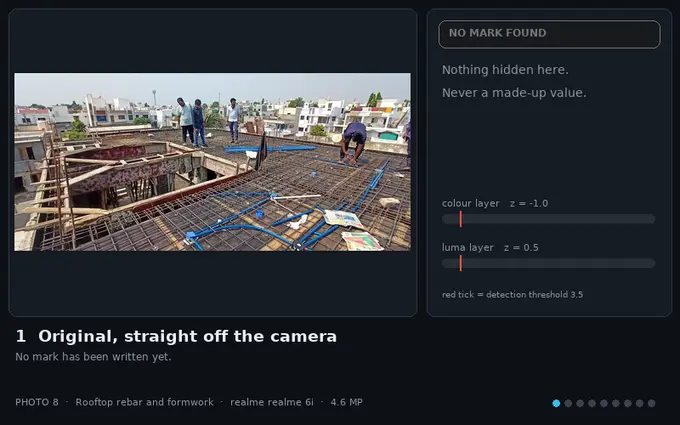
  <br/><sub><b>#8 · Rooftop rebar and formwork</b><br/>realme realme 6i · 5 MP · PSNR 38.4 dB · chat-app z = 17<br/>✅ 10 full · 🟠 1 location-only · 🔴 1 unreadable (of 12 edits)</sub>
</td>
<td width="50%" align="center">
  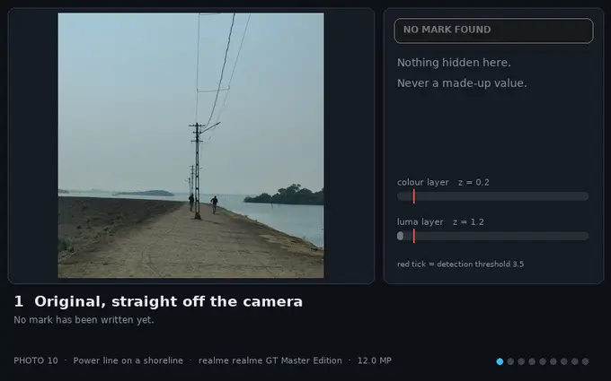
  <br/><sub><b>#10 · Power line on a shoreline</b><br/>realme realme GT Master Edition · 12 MP · PSNR 44.2 dB · chat-app z = 22<br/>✅ 10 full · 🟠 1 location-only · 🔴 1 unreadable (of 12 edits)</sub>
</td>
</tr>
</table>

### 📱 LAVA &nbsp;<sub>3 photos · average 5.0 of 12 edits survived with the full record</sub>

<table>
<tr>
<td width="50%" align="center">
  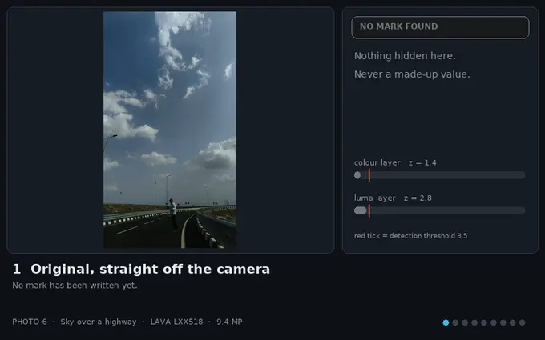
  <br/><sub><b>#6 · Sky over a highway</b><br/>LAVA LXX518 · 9 MP · PSNR 45.5 dB · chat-app z = 14<br/>✅ 9 full · 🔴 3 unreadable (of 12 edits)</sub>
</td>
<td width="50%" align="center">
  
  <br/><sub><b>#21 · Car park from a car</b><br/>LAVA LXX518 · 9 MP · PSNR 43.9 dB · chat-app z = 10<br/>✅ 6 full · 🔴 6 unreadable (of 12 edits)</sub>
</td>
</tr>
<tr>
<td width="50%" align="center">
  
  <br/><sub><b>#22 · Fruit plate</b><br/>LAVA LXX518 · 8 MP · PSNR 43.4 dB · chat-app z = 6<br/>✅ 0 full · 🟠 6 location-only · 🔴 6 unreadable (of 12 edits)</sub>
</td>
<td width="50%"></td>
</tr>
</table>


## 🌗 Black & white: the second layer

> **The question everyone asks:** *"what if someone just turns the photo black &amp; white?"*  Colour is where the full record lives, so a grey photo loses it. That is exactly why Ghostmark writes a **second, independent layer into the brightness** of the picture: it is the part of the photo a black-and-white filter *keeps*.

<div align="center">
  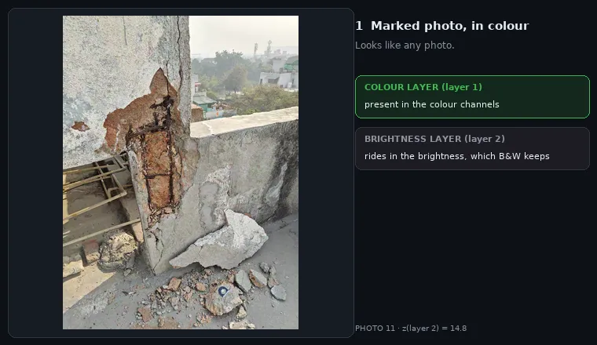
  <p><em>Photo #11, start to finish: marked in colour → turned black &amp; white → squeezed through a chat app (1600 px, JPEG q70) → the brightness layer, magnified ×20 → the location, read back. All of it measured, not mocked up.</em></p>
</div>

### 🔬 Why it survives

<div align="center">
  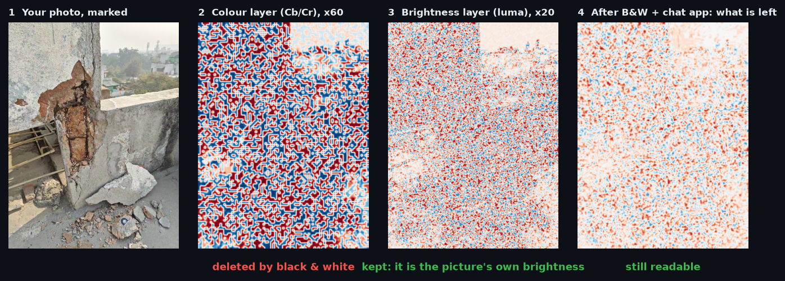
  <p><em>The two layers are orthogonal by construction. Panel 2 is the colour layer: a black-and-white filter throws it away. Panel 3 is the brightness layer: a grey picture <b>is</b> brightness, so the filter hands it straight through. Panel 4 is the black-and-white copy that went through a chat app, minus the same copy of the unmarked photo: the pattern is still there.</em></p>
</div>

The brightness layer is built to be the survivor, not the star: ~50,000 small tiles, a 60-bit payload (**location only, about 10 m**), the same pilot tiles, the same error-correcting code, a higher amplitude (up to 4.5 grey levels, still invisible at 100 %). It cannot carry time or altitude, there is no room, but a location that survives the filters people actually apply is the part that matters most.

### 🖼️ All 40 photos, turned black &amp; white and sent through a chat app

<div align="center">
  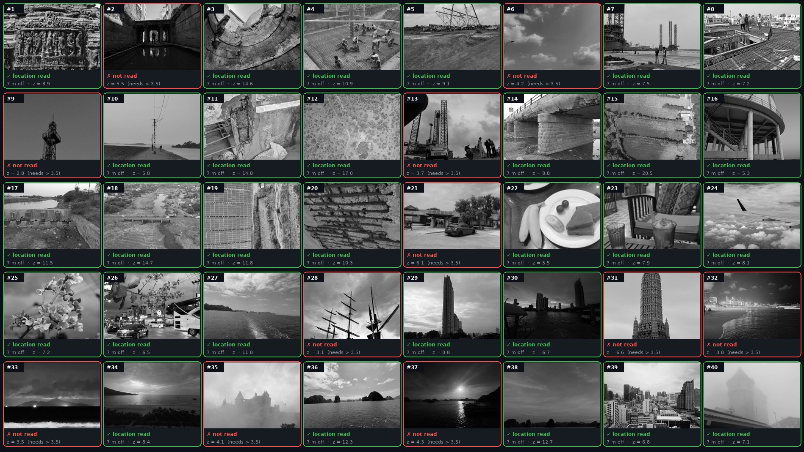
  <p><em>Every test photo as the receiver sees it: grey, 1600 px, JPEG q70. <b>Green frame</b> = the location was read back (the number is how many metres off it was), <b>red frame</b> = not read. The red ones are mostly the dark, foggy and flat scenes, the same weakness we saw in colour.</em></p>
</div>

**29 of 40** photos gave their location back after a black-and-white filter and a chat app, at the default strength, and every one of those reads landed on the same spot, **6.6 m** from the true position: that is the rounding of the 60-bit location grid, not noise.

### 🧪 Nine ways to go grey

Not every "black &amp; white" is the same. A phone filter, a photo editor, a red-filter look and a plain desaturate all mix the colour channels differently, and each is followed by a different delivery path. We tried nine, on every photo:

<div align="center">
  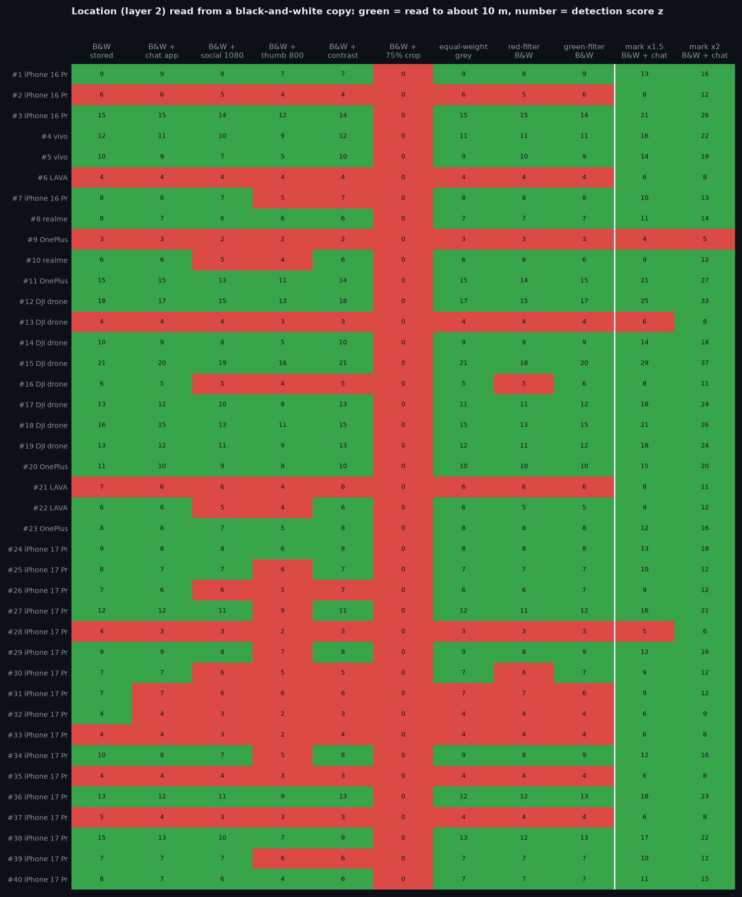
</div>

| Black-and-white path | Location read | Median z (brightness layer) |
|---|:-:|:-:|
| B&W, saved as JPEG q95 | 31 / 40 | 8.1 |
| B&W + chat app (1600 px, q70) | **29 / 40** | 7.3 |
| B&W + social (1080 px, q50) | 24 / 40 | 6.8 |
| B&W + thumbnail (800 px, q40) | 18 / 40 | 5.3 |
| B&W + strong contrast + chat app | 24 / 40 | 7.1 |
| B&W + 75% centre crop + chat app | 0 / 40 | 0.0 |
| Equal-weight grey + chat app | 29 / 40 | 7.3 |
| Red-filter B&W + chat app | 27 / 40 | 7.3 |
| Green-filter B&W + chat app | 29 / 40 | 7.3 |
| Written at **1.5×** strength, B&W + chat app | 37 / 40 | 10.8 |
| Written at **2×** strength, B&W + chat app | 39 / 40 | 14.4 |

<div align="center">
  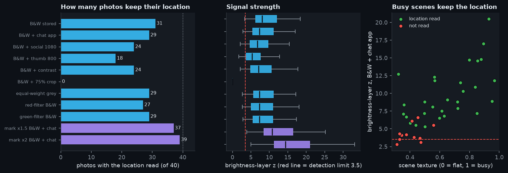
  <p><em>Left: how many photos keep their location. Middle: signal strength per variant against the 3.5 detection limit. Right: signal strength against scene texture for the black-and-white chat copy: busy scenes keep their location, flat and dark ones do not.</em></p>
</div>

### 📌 What the black &amp; white study taught us

1. **It works, with a limit you can see.** 29 of 40 photos at default strength after grey + chat app; the failures are the low-texture photos, the same ones that are fragile in colour (#2, #6, #9, #13, #21, #28, #31, #32, #33, #35, #37).
2. **A stronger mark buys most of it back.** Written at 1.5× the location was read for **37 of 40** photos, at 2× for **39 of 40** (mean PSNR 38.5 dB and 36.0 dB instead of the default 41.8 dB). The Android self-test today checks the colour path (a chat app); teaching it to check a grey copy too is the obvious next step.
3. **Heavy sharing hurts more than the grey, and a crop is a hard stop.** The 800 px / q40 thumbnail reads 18 of 40. A black-and-white copy that is *also cropped* reads 0 of 40: the crop search finds the original frame by its colour pilots, and a grey picture has none. Full-frame grey copies are fine; grey crops are not.
4. **The grey recipe matters a little.** Equal-weight grey: 29, red filter: 27, green filter: 29, against 29 for the standard luma conversion. A red or green filter lets some of the colour layer leak into the grey picture as noise, an equal-weight grey slightly reweights the brightness layer.
5. **Never a wrong location.** Every location that passed the CRC was within **6.6 m** of the truth (the format's grid is about 10 m), across 211 reads. The same grey + chat path on the **unmarked** originals returned "no mark" for 40 of 40 photos.
6. **Two engines, same answer.** The Python engine read the 320 grey copies and agreed with the JavaScript reference engine on status and location in **320 of 320** cases.

## 📊 The lab results

### 🔥 Survival matrix: every photo × every edit

<div align="center">
  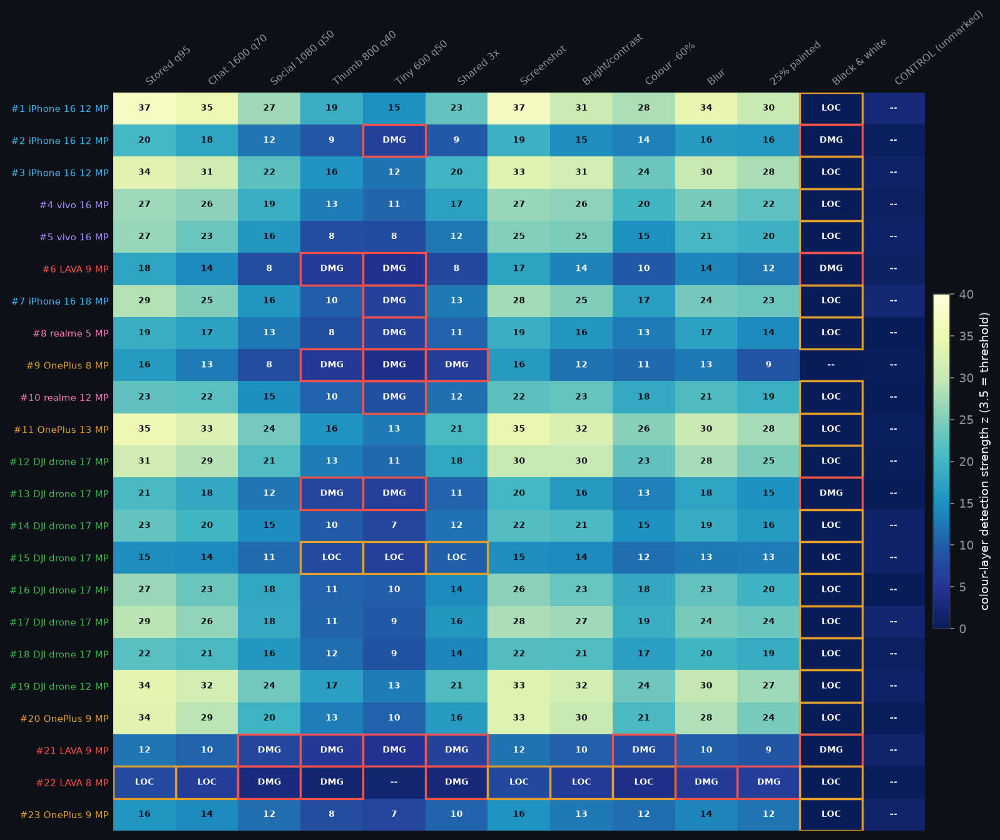
  <p><em>Each cell is the colour-layer detection strength z (threshold 3.5) or a status: <b>LOC</b> = location only (orange frame), <b>DMG</b> = mark present but unreadable (red frame), <b>--</b> = no mark found. Photo labels are coloured by camera.</em></p>
</div>

<table>
<tr>
<td width="55%" align="center">
  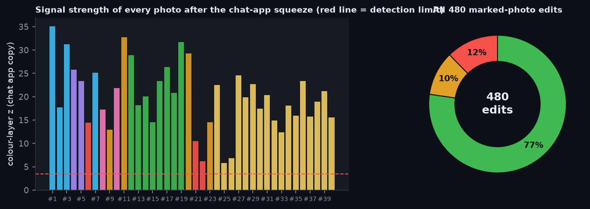
</td>
<td width="45%" valign="middle">

### The scoreboard

**480** attacked copies (40 photos × 12 edits):

- ✅ **371** full records (77.3 %)
- 🟠 **50** location-only recoveries
- 🔴 **59** honestly unreadable
- ❌ **0** wrong values
- 🚫 **0** false alarms on 320 unmarked reads (highest z 3.29 vs threshold 3.5)

</td>
</tr>
</table>

| Edit applied to the stored JPEG | Full record | Location only (layer 2 alone) | Median z |
|---|:-:|:-:|:-:|
| Stored JPEG q95 (full size) | 38 / 40 | 31 / 40 | 22 |
| Chat app: 1600 px, q70 | 38 / 40 | 28 / 40 | 20 |
| Social: 1080 px, q50 | 36 / 40 | 23 / 40 | 15 |
| Thumbnail: 800 px, q40 | 24 / 40 | 18 / 40 | 10 |
| Tiny: 600 px, q50 | 18 / 40 | 12 / 40 | 10 |
| Shared three times (1600 > 1280 > 1080) | 30 / 40 | 21 / 40 | 13 |
| Screenshot-style PNG, 1080 px | 38 / 40 | 27 / 40 | 22 |
| Brightness/contrast edit + 1600 q70 | 38 / 40 | 27 / 40 | 19 |
| Colour drained to 40% + 1600 q70 | 36 / 40 | 28 / 40 | 16 |
| Blur (sigma 1.2) + 1600 q70 | 38 / 40 | 22 / 40 | 20 |
| 25% of area painted over + 1600 q70 | 37 / 40 | 23 / 40 | 16 |
| Black and white + 1600 q70 | 0 / 40 | **29 / 40** (as `PART`) | n/a |
| Crop to 81% of the area (centre 90%), then chat app | 35 / 40 | n/a | n/a |
| Crop to 56% of the area (centre 75%), then chat app | 33 / 40 | n/a | n/a |
| Crop to 36% of the area (centre 60%), then chat app | 32 / 40 | n/a | n/a |
| Crop to 20% of the area (centre 45%), then chat app | 0 / 40 | n/a | n/a |
| Crop to 90% of the area (right 10% trimmed), then chat app | 35 / 40 | n/a | n/a |
| Crop to 25% of the area (top-left quarter), then chat app | 0 / 40 | n/a | n/a |
| Simulated phone photo of a **monitor** (4 tapped corners) | 36 / 40 | n/a | n/a |
| Simulated phone photo of a **print** (4 tapped corners) | 33 / 40 | n/a | n/a |

### 📦 How strong is the signal? Distribution per edit

<div align="center">
  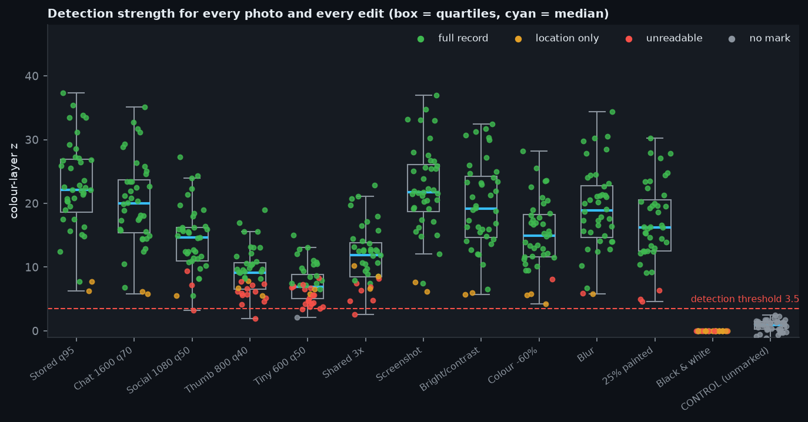
  <p><em>Every dot is one photo. Boxes are quartiles; cyan is the median. Healthy copies sit at z = 15 to 35, the threshold is 3.5, and the unmarked control stays flat on the floor.</em></p>
</div>

### 📉 How small, how squashed?

<div align="center">
  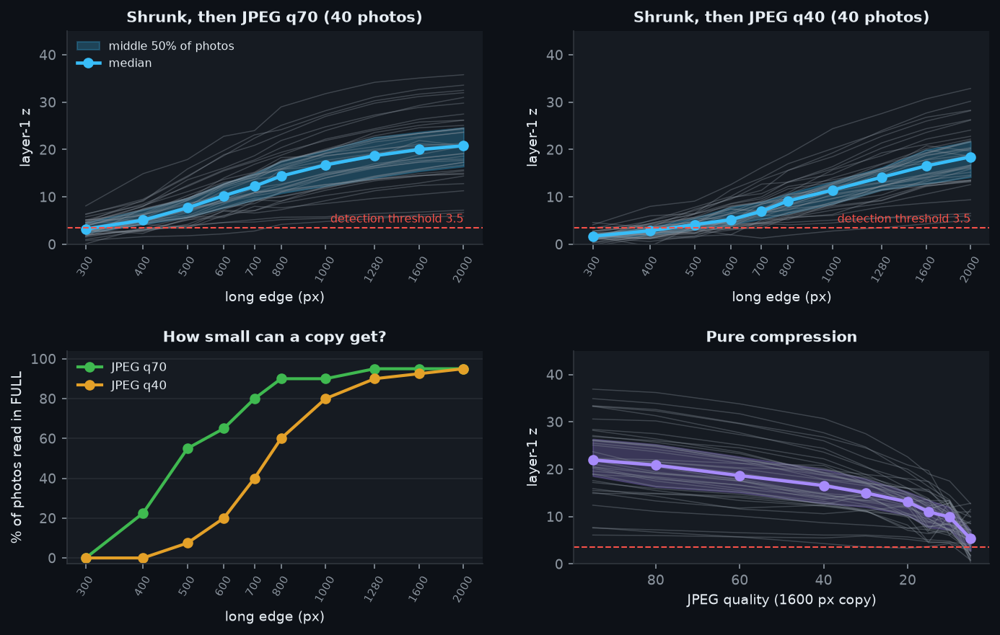
  <p><em>Top: z versus long edge (grey = each photo, cyan band = middle 50 %). Bottom left: the share of photos still read in full. Bottom right: JPEG quality alone, on a 1600 px copy.</em></p>
</div>

### 🕵️ Never cries wolf, and why busy scenes win

<div align="center">
  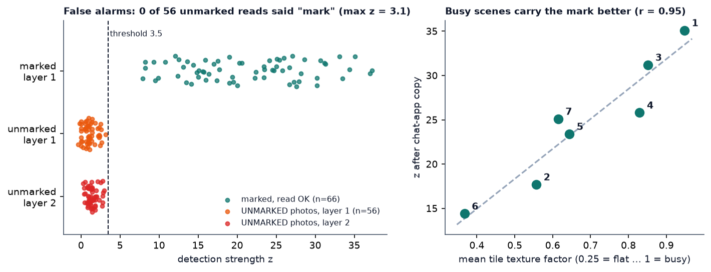
  <p><em>Left: 320 reads of unmarked photos (8 degradations × 40 photos) never crossed the threshold; real reads start at z ≈ 5.5. Right: detection strength follows scene texture (r = 0.62).</em></p>
</div>

### ✂️ Crops, 📺 screens and ⏱️ speed

<div align="center">
  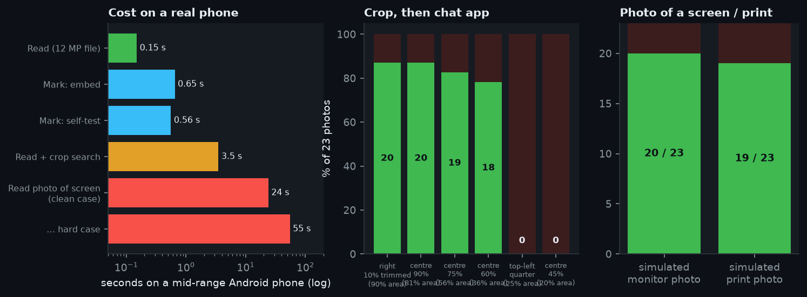
  <p><em>Crop, then chat app: a 10 % trim or centred 90 % / 75 % / 60 % crop is found and read in most photos (35, 35, 33, 32 of 40); a 45 % or quarter-frame crop is not (0 and 0 of 40). Simulated phone photos of a monitor: 36 of 40 read in full; of a print: 33 of 40.</em></p>
</div>

### 📱 Does the camera matter?

<div align="center">
  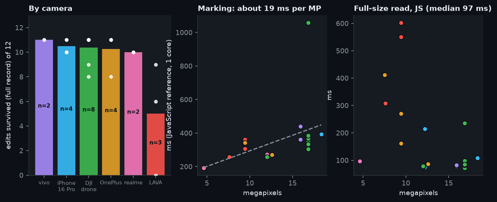
  <p><em>Left: edits survived per camera (dots = individual photos). Middle: marking time on the JavaScript reference engine, measured one photo at a time on one PC core (about 13.9 ms per megapixel, median 306.5 ms; the Kotlin engine on a phone takes ~1.2 s for 12 MP including the self-test). Right: a full-size read, median 110.5 ms.</em></p>
</div>

### 🎚️ The visibility ↔ survival trade-off

The mark strength is a dial. We re-marked every photo at five strengths and measured both invisibility and survival.

<div align="center">
  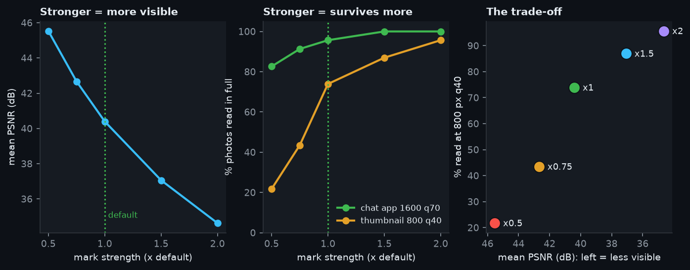
</div>

| Strength (× default) | Mean PSNR | Chat app (1600 px q70) read in full | Thumbnail (800 px q40) read in full |
|:-:|:-:|:-:|:-:|
| 0.5× | 46.5 dB | 85% | 12% |
| 0.75× | 43.9 dB | 90% | 28% |
| **1× (default)** | **41.7 dB** | **95%** | **60%** |
| 1.5× | 38.5 dB | 98% | 88% |
| 2× | 36.0 dB | 100% | 95% |

**Take-away:** the default (1×) already reads 38 of 40 photos after a chat app, but only 60.0 % survive an 800 px / q40 thumbnail. Raising the strength to 1.5× to 2× rescues most of the rest, at a visible cost (mean PSNR drops from 41.7 to 36.0 dB). That is exactly why Ghostmark ships a **capture-time self-test**: it simulates a chat app on the fresh photo and raises the strength (up to 1.9×) *only for the photos that need it*, so a textured temple stays subtle and a smooth plate gets help. In this benchmark 16 photos are lost at 800 px / q40 with the 1× mark, and **14 of them are read in full once the strength is doubled**. The photos that fail even as a stored copy at 1× are #22, #25 (a dark plate of fruit, and blossoms against a dusk sky): exactly the case the self-test exists for.

## 🏆 Leaderboard: who survives best?

<div align="center">
  
</div>

<table>
<tr>
<td width="50%" valign="top">

**The five most robust photos**

| # | Scene | Camera | Texture | Brightness | Chat-app z | Full reads |
|:-:|---|---|:-:|:-:|:-:|:-:|
| 1 | Carved stone temple | iPhone 16 Pro | 0.95 | 111 | 35 | 11 / 12 |
| 11 | Cracked concrete column | OnePlus 11 5G | 0.88 | 151 | 33 | 11 / 12 |
| 19 | Drone: solar farm | M3T | 0.97 | 133 | 32 | 11 / 12 |
| 3 | Stone well, looking up | iPhone 16 Pro | 0.85 | 84 | 31 | 11 / 12 |
| 20 | Weathered brick wall | OnePlus Nord2 5G | 0.76 | 108 | 29 | 11 / 12 |

</td>
<td width="50%" valign="top">

**The five most fragile photos**

| # | Scene | Camera | Texture | Brightness | Chat-app z | Full reads |
|:-:|---|---|:-:|:-:|:-:|:-:|
| 25 | Blossom at dusk | iPhone 17 Pro | 0.50 | 121 | 6 | 0 / 12 |
| 22 | Fruit plate | LXX518 | 0.44 | 121 | 6 | 0 / 12 |
| 26 | Rainy street at night | iPhone 17 Pro | 0.60 | 118 | 7 | 6 / 12 |
| 21 | Car park from a car | LXX518 | 0.41 | 152 | 10 | 6 / 12 |
| 33 | Storm over a night sea | iPhone 17 Pro | 0.33 | 66 | 12 | 7 / 12 |

</td>
</tr>
</table>

## 🔬 What we learned

1. **Texture is destiny.** The marks that survive best live in rubble, rebar, stone and foliage. Flat sky, dark water and smooth plates are the weak spots, by design: the adaptive rule withholds the mark where it would be visible, and there is less pattern to hide in.
2. **Resolution matters more than JPEG quality.** The reader keeps working down to JPEG q10 at 1600 px, but falls apart below roughly 600 to 800 px on the long edge. Chat apps resize; they rarely crush quality that far.
3. **The luma layer earns its place.** Convert a photo to black &amp; white and the colour layer is gone for every photo. The brightness layer still returned the location for **29 of 40** photos after a chat app (median error 6.6 m), and **39 of 40** when the mark is written at twice the strength. That is the whole point of having two independent layers: see the [black &amp; white special](#-black--white-the-second-layer).
4. **Never a wrong answer.** The CRC-16 plus the convolutional code turned every uncertain read into an honest `PART` or `DAMAGED`, not into a plausible-looking wrong coordinate: **0 wrong values** across 480 edits and 320 unmarked controls.
5. **A new camera generation, same behaviour.** The 17 iPhone 17 Pro photos survived 8.7 of 12 edits on average (iPhone 16 Pro: 10.5). Many of them are the hard kind (dusk, fog, night sea), which is why the average dropped when they joined the bench.
6. **Photos of screens and prints are viable, with help.** With four tapped corners the reader aligned and decoded 36 of 40 simulated monitor shots and 33 of 40 print shots; that takes about 20.3 s per photo on a PC core, and 24 to 55 s on a phone. Real hardware is harsher than the simulator, see the limits below.
7. **Drones are fine.** Aerial scenes (fields, scrub, solar panels) are almost pure texture: the 8 DJI photos survived 10.4 of 12 edits on average, on par with the flagship phones (10.5); the weakest group was the budget LAVA phone (5.0), whose photos here were the smoothest and darkest.

## ⚙️ How it works

<div align="center">
  
</div>

<table>
<tr>
<td width="25%" valign="top">

**🎨 Layer 1: colour**

~10,000 tiles in Cb/Cr, ±(≤2) grey levels. 118 bits: location, altitude, time, 0.1 s, live/manual, CRC-16. Rate-½ convolutional code → 248 coded bits, ~32 tiles per bit.

</td>
<td width="25%" valign="top">

**💡 Layer 2: brightness**

~50,000 tiles in luma carry only the location (60 bits, ~10 m). Weaker, but it **survives black &amp; white**.

</td>
<td width="25%" valign="top">

**📍 Pilot tiles**

20% of tiles have a known sign. The reader correlates against them to detect, to align after a crop, to fix a tilted photo of a screen, and as a built-in false-alarm test.

</td>
<td width="25%" valign="top">

**🛡️ Self-test**

At capture the engine squeezes a copy like a chat app would, reads it, and strengthens the mark (up to ×1.9) if it did not survive.

</td>
</tr>
</table>

<div align="center">
  
</div>

<div align="center">
  
  <p><em>Case study: photo #1 through eight stages. The unmarked original returns "no mark", never a guess.</em></p>
</div>

Exact bit layout: [FORMAT-SPEC.md](engine/FORMAT-SPEC.md). The JavaScript implementation in [`reference/`](reference/) wins over the text if they ever disagree.

## ⚠️ Honest limits

<table>
<tr>
<td width="50%" valign="top">

- **Not a proof of authenticity.** Anyone with the engine can write a mark. It keeps *honest* metadata alive; a tamper hint fires if the two layers disagree by more than 30 m.
- **Flat, dark or smooth photos are fragile** (see the leaderboard): fine at chat size, lost at small sizes unless the self-test strengthens them.
- **Black &amp; white** keeps the location only, and 11 of 40 photos (mostly dark, foggy or flat) lose even that at default strength.
- **Crops:** centred crops down to about 36 % of the area were found; a 20 % or quarter-frame crop was not.

</td>
<td width="50%" valign="top">

- **Photos of screens:** the simulator is kinder than reality. A real monitor photo read (z = 12.7, 24 s on the phone); another, shown at 100 % zoom with strong moiré, was lost.
- **Not supported:** heavy denoising or AI retouching, pictures below 64 px, times before 2026-01-01 or after ~2043.
- **Benchmark scope:** attacks ran on the JavaScript reference engine at default strength, on 40 photos from 11 cameras (the Python engine reproduced the black-and-white reads exactly, 320 of 320).
- **Python engine:** reading a photo of a screen takes about a minute in pure Python; `read_cropped` and `read_perspective` expect an upright picture; the Android engine is the one phone-tested in the field. Treat percentages as indicative, not as a guarantee for every scene.

</td>
</tr>
</table>

## 🐍 Ghostmark for Python

The Android engine is the production one. For everything that is **not** an Android app (a server that checks uploaded photos, a batch tool for a survey team, a Jupyter notebook, a desktop app, a Raspberry Pi on a drone) there is now a **Python engine** in [`python/`](python/): the same mark format, written with `numpy` only (Pillow optional, for file helpers and the self-test).

<div align="center">
  
  <p><em>A real run of <a href="python/examples/mark_and_read.py"><code>python/examples/mark_and_read.py</code></a> (output not edited).</em></p>
</div>

```bash
pip install "ghostmark-image[files]"   # numpy (+ Pillow for the file helpers); Python 3.9+
ghostmark mark photo.jpg marked.jpg --lat 12.9716 --lon 77.5946 --alt 920 --time 2026-10-25T12:00:00Z
ghostmark read shared_copy.jpg       # status ok = full record; part = location only (+-10 m); none = no mark
```

```python
import numpy as np
from PIL import Image
import ghostmark as gm

rgb = np.asarray(Image.open("photo.jpg").convert("RGB"))
marked, strength = gm.mark_verified(rgb, gm.Record(lat=12.9716, lon=77.5946, alt=920, t=1792929600))
Image.fromarray(marked).save("marked.jpg", quality=95, subsampling=0)

r = gm.read(np.asarray(Image.open("whatsapp_copy.jpg").convert("RGB")))
r.status      # 'ok' | 'part' | 'damaged' | 'none'
r.location    # (lat, lon) from the best layer that was read, or None
r.time        # UTC datetime (full record only)
```

| | Python engine |
|---|---|
| **Same format** | reads every mark the Kotlin and JavaScript engines write, and the other way round (marks written by Python were read in full by the JavaScript engine for 38 of 40 photos, and marks written by JavaScript were read in full by Python for 38 of 40) |
| **API** | `mark` · `mark_verified` (chat-app self-test) · `read` · `read_cropped` · `read_perspective` · `auto_corners` · `mark_file` · `read_file` · CLI `ghostmark` |
| **Dependencies** | `numpy` only; `Pillow` for files and the self-test |
| **Speed (12 MP, one core)** | mark ≈ 2.1 s · read ≈ 0.5 s · crop search ≈ 5.5 s · screen/print ≈ 48.9 s |
| **Tests** | 14 `pytest` tests, including the Android engine's cross-language fixtures |
| **Not in the Python port** | native speed (it is numpy, not NEON) |

Full guide: [`python/README.md`](python/README.md).

## 🚀 Quick start

```kotlin
// settings.gradle.kts → include(":engine")   |   app → implementation(project(":engine"))
// 1. At capture, after your overlay is drawn and before JPEG encoding (background thread):
val record = MarkRecord(lat, lon, altitudeMeters = alt, timeSeconds = Math.floorDiv(shutterMillis, 1000L),
                        tenth = (Math.floorMod(shutterMillis, 1000L) / 100).toInt())
InvisibleMark.mark(finalBitmap, record)            // null = failed: save the photo unmarked

// 2. Any time later, on any copy:
val read = InvisibleMark.read(context, uri, ReadOptions(searchCrops = true))
when (read?.result?.status) {                      // OK · PART · DAMAGED · NONE
    MarkStatus.OK   -> read.result.layer1          // lat, lon, alt, time, manual flag
    MarkStatus.PART -> read.result.layer2          // location only, ~10 m
    else -> { /* tell the user. never invent a value */ }
}
```

Full API, four integration flows and an AI-assistant checklist: [`engine/ENGINE.md`](engine/ENGINE.md). Not on Android? See [Ghostmark for Python](#-ghostmark-for-python).

| | Measured on a real phone (12 MP) |
|---|---|
| Mark (embed + self-test) | ~0.65 s + ~0.56 s |
| Read | ~0.15 s |
| Read with crop search | 2.5 to 4.6 s |
| Read a photo of a screen / print | 24 s (clean case) to ~55 s |

## 📦 What's in the box

```
engine/       the Android library: source, ENGINE.md, FORMAT-SPEC.md, 29 JVM tests with cross-language fixtures
python/       the Python engine (numpy only): package, CLI, 14 tests, examples
PR-KIT/       launch toolkit: social preview, post drafts, release notes, FAQ (not needed to use the library)
dist/         prebuilt ghostmark-1.1.0.aar (97 KB)
trial/        small Compose sample app: Capture, Read, Screen/print with a corner editor
reference/    JavaScript reference implementation + CLI
samples/      demo photos, marked (1600 px, EXIF-free): send them through any messenger and read them back
tools/        run_experiments.py → run_bw.py → make_figures.py → make_bw.py → make_showcase.py → make_readme.py (builds this page from the data)
assets/       README media
```

```
gradlew :engine:testDebugUnitTest :engine:assembleRelease :trial:assembleDebug
cd python && pip install -e .[test] && pytest -q
cd tools && python run_experiments.py && python run_bw.py && python make_figures.py && python make_bw.py && python make_showcase.py && python make_readme.py
# needs numpy, opencv-python, matplotlib, pillow, node. Set MARK_PHOTOS=<folder> to use your own photos.
```

Benchmark note: attacks ran on the JavaScript reference engine, which shares format and maths with the Kotlin engine (cross-checked by shared fixtures in both directions). Photos above 24 MP are downscaled to a 4096 px long edge first, as the Android engine does (that affects only the 50 MP photo). On-phone timings and the two real monitor photos come from the Kotlin engine on a 1220 × 2712 Android phone.

## 📜 Licence and credit

**Open source under the [Apache License 2.0](LICENSE).** Use it, change it, ship it, commercially or not, in any app or tool. The one thing we ask is the thing the licence already requires: **keep the credit.** Keep the [`NOTICE`](NOTICE) file with your distribution, and we would love a line in your About screen or docs:

> Uses Ghostmark by Vijay Parmar, github.com/thevijayparmar/Ghostmark-Image

Copyright © 2026 Vijay Parmar. Contributions are welcome: see [CONTRIBUTING.md](CONTRIBUTING.md).

**Contributors:** [Vijay Parmar](https://github.com/thevijayparmar) · [Prathvi Bhatti](https://github.com/poronita) (co-author)

<div align="center">
  <br/>
  <sub>👻 Built by <a href="https://github.com/thevijayparmar">Vijay Parmar</a> · the photo remembers, even when the file forgets.</sub>
</div>
