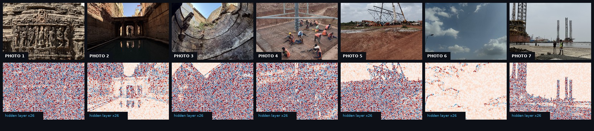
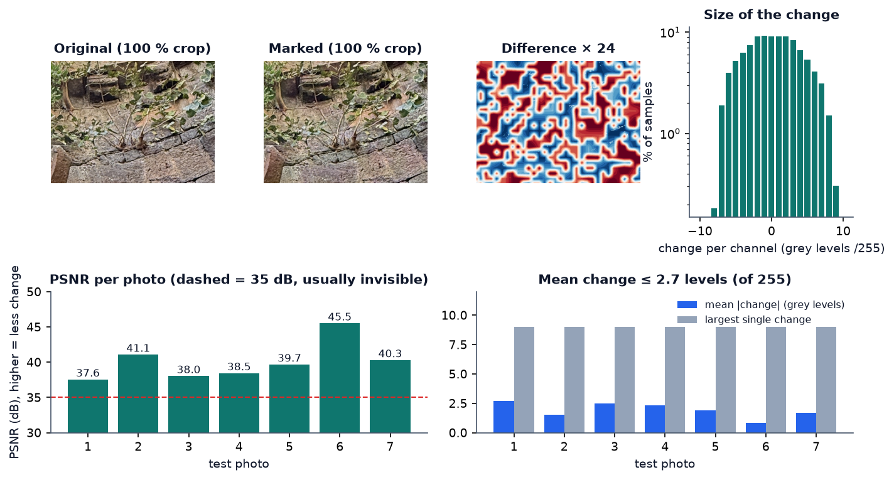
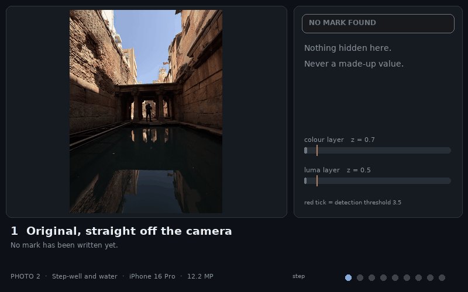
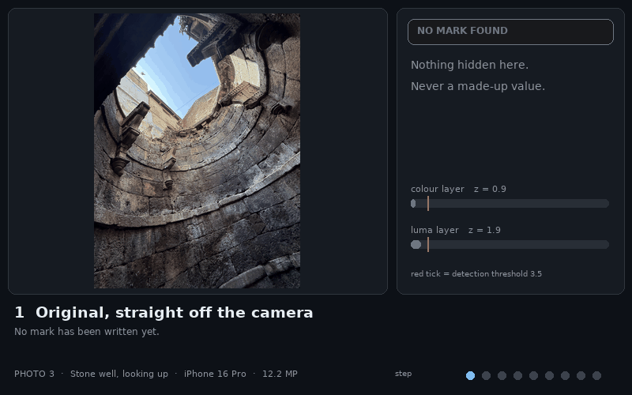
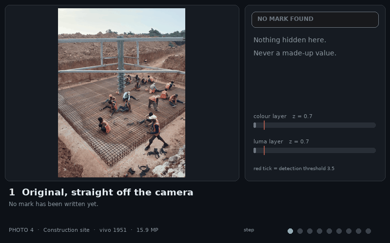
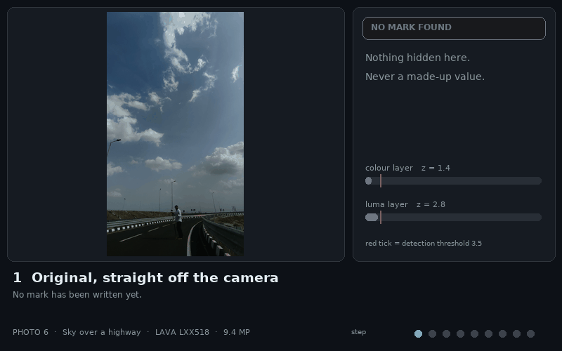
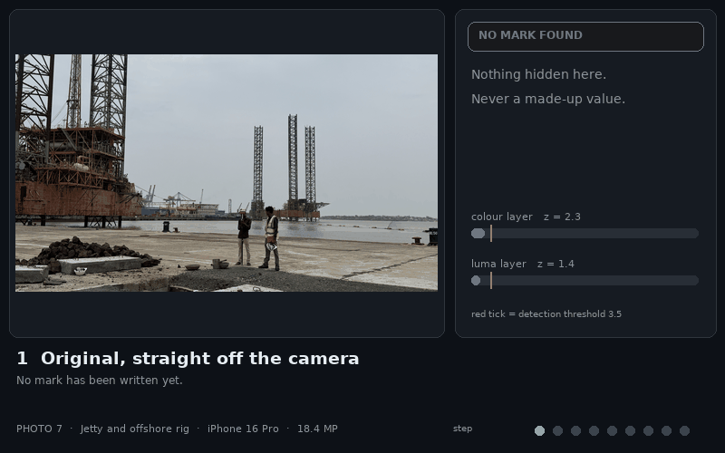

<div align="center">
  
</div>

<br>

<div align="center">

  <a href="LICENSE"></a>
  
  
  
  
  
  

</div>

<br>

<div align="center">
  <h1>👻 Ghostmark</h1>
  <p><strong>Photos that remember where and when they were taken, even after the metadata is gone.</strong></p>
  <p>An Android library that hides <b>location (~1 m), altitude, UTC time (0.1 s)</b> and a live/manual flag <i>inside the pixels</i> of a photo, invisibly, so the record survives WhatsApp, screenshots, crops and even a phone photo of a screen.</p>
  <p><code>Ghostmark-Image</code> · engine 1.1.0 · no UI · no permissions · no network · no native code</p>
</div>

<div align="center">
  <a href="https://www.linkedin.com/in/thevijayparmar/">
    
  </a>
  &nbsp;
  <a href="../../issues">
    
  </a>
  &nbsp;
  <a href="../../issues">
    
  </a>
</div>

---

> ⏳ **Heads up: this page is GIF-heavy.** The gallery has eight animated showcases (one for each of the 7 test photos plus the hero) so you can watch every test without installing anything. They take a few seconds to load.

<div align="center">
  
</div>

---

## 🎬 See it in action

<div align="center">
  
  <p><em>One photo, two views. The scan line reveals the invisible pattern that carries the record, then the reader decodes it in 0.15 s.</em></p>
</div>

### Why a pixel mark?

<table>
<tr>
<td width="50%" valign="top">

**❌ EXIF (what everyone relies on)**

GPS and time live in file metadata. A chat app, a screenshot, a "save as" or a crop deletes them silently, and then the photo is just a picture.

</td>
<td width="50%" valign="top">

**✅ Ghostmark**

The record is spread over ~10,000 colour tiles and ~50,000 brightness tiles, protected by a CRC and an error-correcting code. Any copy that still looks like the photo still carries it.

</td>
</tr>
</table>

## 🧬 The hidden layer, made visible

The top row is what the camera shot. The bottom row is the **difference** between the marked and the original photo, magnified 26 times. Look at photo 6: the mark is nearly absent in the flat sky and strong on the busy road. That is the **texture-adaptive** rule keeping the change invisible where your eye would catch it.

<div align="center">
  
</div>

<div align="center">
  
  <p><em>Average change 0.9 to 2.7 grey levels of 255; never more than 9. PSNR 37.6 to 45.5 dB.</em></p>
</div>

## 🖼️ The seven-photo gauntlet

Every photo below was marked with a demo record (12.97160 N, 77.59457 E, 920 m, 2026-10-25 12:00:00.4 UTC) and then put through the **same nine steps**: original, reveal, save, chat app, 600 px thumbnail, black &amp; white, a quarter painted over, a 10% crop, and a (simulated) phone photo of a monitor. Green means the full record came back, orange means location only, red means the mark is there but unreadable. Failures are shown on purpose.

<table>
<tr>
<td width="50%" align="center">
  
  <br/><sub><b>Photo 1 · carved temple · iPhone 16 Pro · 12 MP</b><br/>✅ 6 full reads · 🟠 B/W gives location only · PSNR 37.6 dB</sub>
</td>
<td width="50%" align="center">
  
  <br/><sub><b>Photo 2 · step-well and water · iPhone 16 Pro · 12 MP</b><br/>✅ 5 full reads · 🔴 600 px and B/W unreadable (dark, low texture) · PSNR 41.1 dB</sub>
</td>
</tr>
<tr>
<td width="50%" align="center">
  
  <br/><sub><b>Photo 3 · stone well, looking up · iPhone 16 Pro · 12 MP</b><br/>✅ 6 full reads · 🟠 B/W location only · strong signal (z = 31) · PSNR 38.0 dB</sub>
</td>
<td width="50%" align="center">
  
  <br/><sub><b>Photo 4 · construction site · vivo 1951 · 16 MP</b><br/>✅ 6 full reads (even the 600 px thumbnail) · 🟠 B/W location only · PSNR 38.5 dB</sub>
</td>
</tr>
<tr>
<td width="50%" align="center">
  
  <br/><sub><b>Photo 5 · crane erection site · vivo 1951 · 16 MP</b><br/>✅ 6 full reads · 🟠 B/W location only · PSNR 39.7 dB</sub>
</td>
<td width="50%" align="center">
  
  <br/><sub><b>Photo 6 · sky over a highway · LAVA LXX518 · 9 MP</b><br/>✅ 5 full reads · 🔴 600 px and B/W unreadable (mostly flat sky) · PSNR 45.5 dB</sub>
</td>
</tr>
<tr>
<td width="50%" align="center">
  
  <br/><sub><b>Photo 7 · jetty and offshore rig · iPhone 16 Pro · 18 MP</b><br/>✅ 5 full reads · 🟠 B/W location only · 🔴 600 px unreadable · PSNR 40.3 dB</sub>
</td>
<td width="50%" align="center" valign="middle">
  <h3>Scoreboard</h3>
  <p>49 attacked copies<br/><b>39</b> full records ✅<br/><b>5</b> location-only 🟠<br/><b>5</b> honestly unreadable 🔴<br/><b>0</b> wrong values<br/><b>0</b> false alarms on 7 unmarked originals</p>
  <sub>Simulated monitor photos used hand-tapped corners about 1% off.</sub>
</td>
</tr>
</table>

## 📊 The lab results

<table>
<tr>
<td width="100%" align="center">
  
  <br/><sub><b>7 photos × 12 edits.</b> Every cell is the read status and the colour-layer detection strength z. Threshold: 3.5. Full records survive anything that leaves the picture at 1080 px or larger.</sub>
</td>
</tr>
</table>

<table>
<tr>
<td width="50%" align="center">
  
  <br/><sub><b>How small, how squashed?</b> Detection falls smoothly with resolution and JPEG quality. Unreliable below ~800 px or ~q10. Red crosses mark failed reads.</sub>
</td>
<td width="50%" align="center">
  
  <br/><sub><b>Never cries wolf.</b> 56 unmarked reads, zero false alarms (highest z 3.1 versus 3.5). Busy scenes carry the mark better (r = 0.95).</sub>
</td>
</tr>
</table>

<div align="center">
  
  <p><em>Case study: one carving photo through eight stages. The unmarked original returns "no mark", never a guess.</em></p>
</div>

<div align="center">
  
  <p><em>Cost on a real phone, crop outcomes over the 7 photos, and simulated monitor/print photos (14 of 14 read in full).</em></p>
</div>

| Edit applied to the stored JPEG | Full record | Location only | Median z |
|---|:-:|:-:|:-:|
| Chat app: 1600 px, q70 | 7 / 7 | 5 / 7 | 25 |
| Screenshot-style PNG, 1080 px | 7 / 7 | 5 / 7 | 27 |
| Brightness/contrast, then chat app | 7 / 7 | 5 / 7 | 25 |
| Colour drained to 40%, then chat app | 7 / 7 | 5 / 7 | 17 |
| Blur σ = 1.2, then chat app | 7 / 7 | 4 / 7 | 24 |
| 25% of frame painted over | 7 / 7 | 5 / 7 | 22 |
| Social: 1080 px, q50 | 7 / 7 | 4 / 7 | 16 |
| Thumbnail: 800 px, q40 | 6 / 7 | 4 / 7 | 12 |
| Tiny: 600 px, q50 | 4 / 7 | 2 / 7 | 11 |
| Black & white, then chat app | 0 / 7 | 5 / 7 (as `PART`) | n/a |
| Centred 75% crop, then chat app | 7 / 7 | n/a | n/a |
| Centred 55% crop, then chat app | 3 / 7 | +1 | n/a |
| Quarter-area corner crop | 0 / 7 | 0 / 7 | n/a |

## ⚙️ How it works

<div align="center">
  
</div>

<table>
<tr>
<td width="25%" valign="top">

**🎨 Layer 1: colour**

~10,000 tiles in Cb/Cr, ±(≤2) grey levels. 118 bits: location, altitude, time, 0.1 s, live/manual, CRC-16. Rate-½ convolutional code → 248 coded bits, ~32 tiles per bit.

</td>
<td width="25%" valign="top">

**💡 Layer 2: brightness**

~50,000 tiles in luma carry only the location (60 bits, ~10 m). Weaker, but it **survives black &amp; white**.

</td>
<td width="25%" valign="top">

**📍 Pilot tiles**

20% of tiles have a known sign. The reader correlates against them to detect, align after a crop, and fix a tilted photo of a screen, and as a built-in false-alarm test.

</td>
<td width="25%" valign="top">

**🛡️ Self-test**

At capture the engine squeezes a copy like a chat app would, reads it, and strengthens the mark (up to ×1.9) if it did not survive.

</td>
</tr>
</table>

<div align="center">
  
</div>

Exact bit layout: [FORMAT-SPEC.md](engine/FORMAT-SPEC.md). The JavaScript implementation in [`reference/`](reference/) wins over the text if they ever disagree.

## ⚠️ Honest limits

<table>
<tr>
<td width="50%" valign="top">

- **Not a proof of authenticity.** Anyone with the engine can write a mark. It keeps *honest* metadata alive; a tamper hint fires if the two layers disagree by more than 30 m.
- **Flat or dark photos are fragile** (photos 2 and 6): fine at chat size, lost at 600 px.
- **Black &amp; white** keeps the location only; very dark photos can lose even that.
- **Crops:** 10% trims and centred 75% crops read; a quarter-area corner crop did not.

</td>
<td width="50%" valign="top">

- **Photos of screens:** simulated shots read 14 of 14, but real hardware is harsher. A real monitor photo read (z = 12.7, 24 s on the phone); another, shown at 100% zoom with strong moiré, was lost.
- **Not supported:** heavy denoising or AI retouching, pictures below 64 px, times before 2026-01-01 or after ~2043.
- **Tested on 7 photos.** Treat percentages as indicative, not as a guarantee for every scene.

</td>
</tr>
</table>

## 🚀 Quick start

```kotlin
// settings.gradle.kts → include(":engine")   |   app → implementation(project(":engine"))
// 1. At capture, after your overlay is drawn and before JPEG encoding (background thread):
val record = MarkRecord(lat, lon, altitudeMeters = alt, timeSeconds = Math.floorDiv(shutterMillis, 1000L),
                        tenth = (Math.floorMod(shutterMillis, 1000L) / 100).toInt())
InvisibleMark.mark(finalBitmap, record)            // null = failed: save the photo unmarked

// 2. Any time later, on any copy:
val read = InvisibleMark.read(context, uri, ReadOptions(searchCrops = true))
when (read?.result?.status) {                      // OK · PART · DAMAGED · NONE
    MarkStatus.OK   -> read.result.layer1          // lat, lon, alt, time, manual flag
    MarkStatus.PART -> read.result.layer2          // location only, ~10 m
    else -> { /* tell the user. never invent a value */ }
}
```

Full API, four integration flows and an AI-assistant checklist: [`engine/ENGINE.md`](engine/ENGINE.md).

| | Measured on a real phone (12 MP) |
|---|---|
| Mark (embed + self-test) | ~0.65 s + ~0.56 s |
| Read | ~0.15 s |
| Read with crop search | 2.5 to 4.6 s |
| Read a photo of a screen / print | 24 s (clean case) to ~55 s |

## 📦 What's in the box

```
engine/       the library: source, ENGINE.md, FORMAT-SPEC.md, 29 JVM tests with cross-language fixtures
dist/         prebuilt ghostmark-1.1.0.aar (97 KB)
trial/        small Compose sample app: Capture, Read, Screen/print with a corner editor
reference/    JavaScript reference implementation + CLI
samples/      the 7 demo photos, marked (1600 px, EXIF-free): send them through any messenger and read them back
tools/        run_experiments.py → results/*.json · make_figures.py · make_showcase.py → every chart and GIF above
assets/       README media
```

```
gradlew :engine:testDebugUnitTest :engine:assembleRelease :trial:assembleDebug
cd tools && python run_experiments.py && python make_figures.py && python make_showcase.py
# needs numpy, opencv-python, matplotlib, pillow, node. Set MARK_PHOTOS=<folder> to use your own photos.
```

Benchmark note: attacks ran on the JavaScript reference engine, which shares format and maths with the Kotlin engine (cross-checked by shared fixtures in both directions). On-phone timings and the two real monitor photos come from the Kotlin engine on a 1220 × 2712 Android phone.

## 📜 Licence and credit

Copyright © 2026 **Vijay Parmar**. Free to use, modify and ship inside your own apps, including commercial ones, **as long as you credit the author**, for example in your About screen:

> Uses Ghostmark by Vijay Parmar, github.com/thevijayparmar/Ghostmark-Image

The engine may not be resold or republished as a stand-alone library or SDK. The binding text is in [LICENSE](LICENSE).

<div align="center">
  <br/>
  <sub>👻 Built by <a href="https://github.com/thevijayparmar">Vijay Parmar</a> · the photo remembers, even when the file forgets.</sub>
</div>
